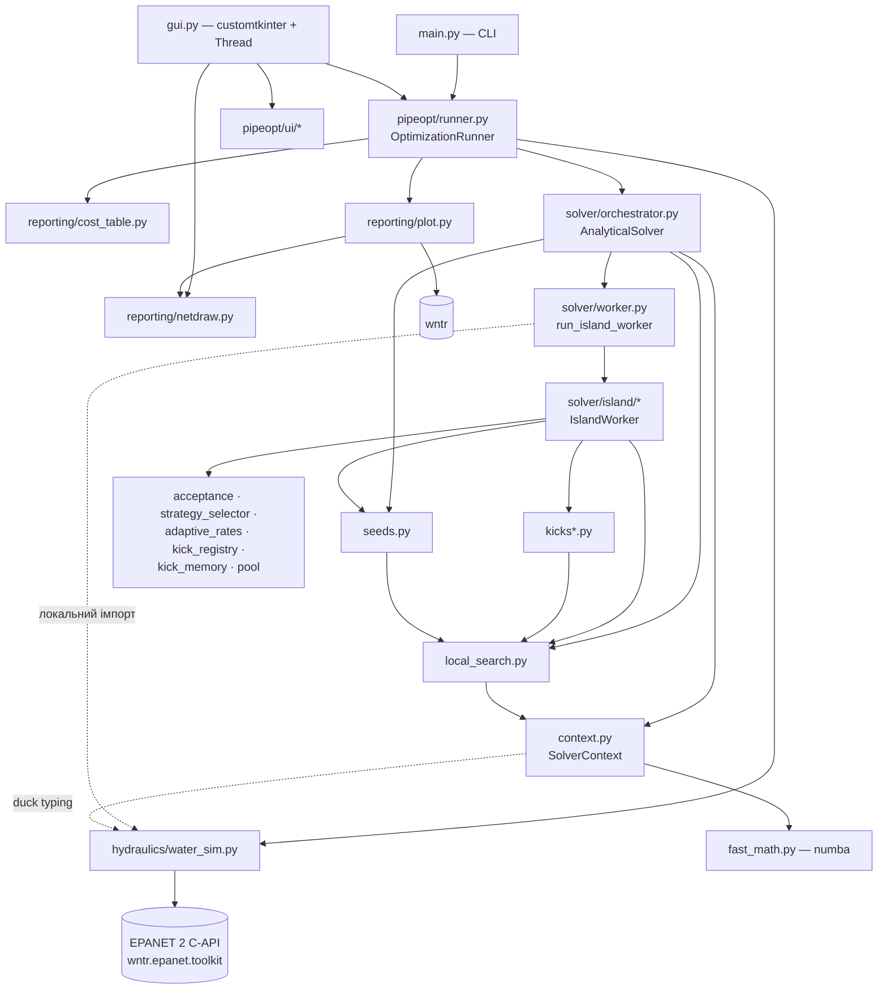
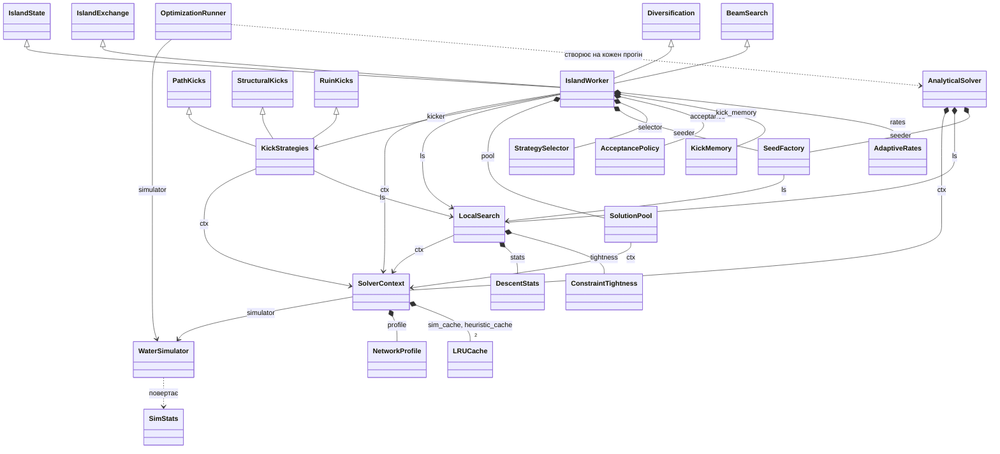
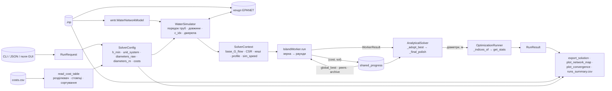
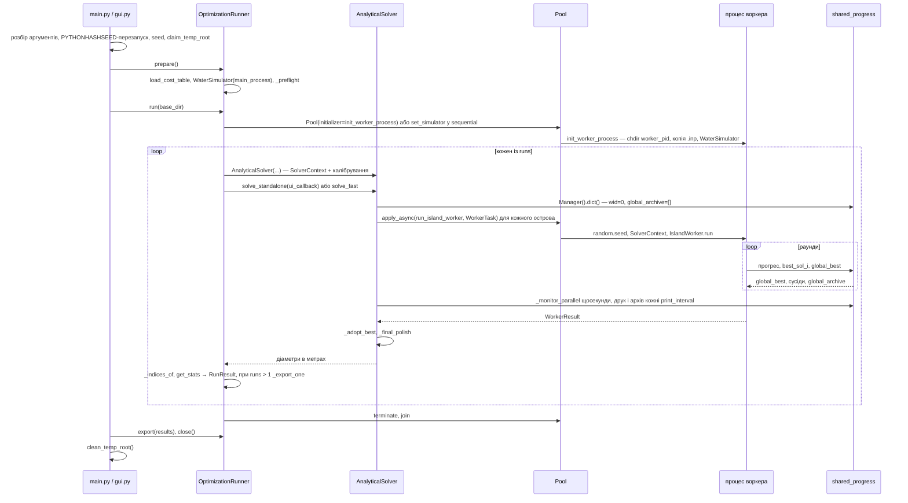
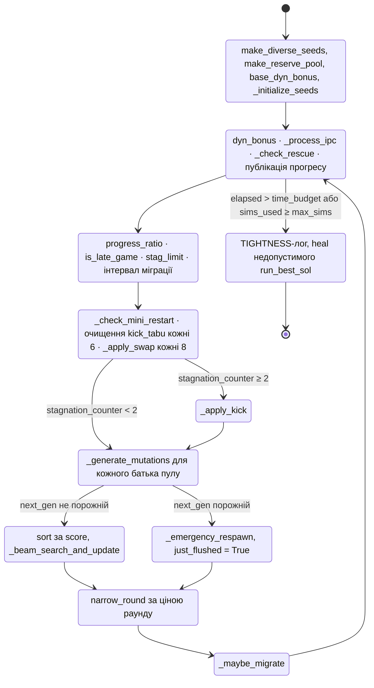
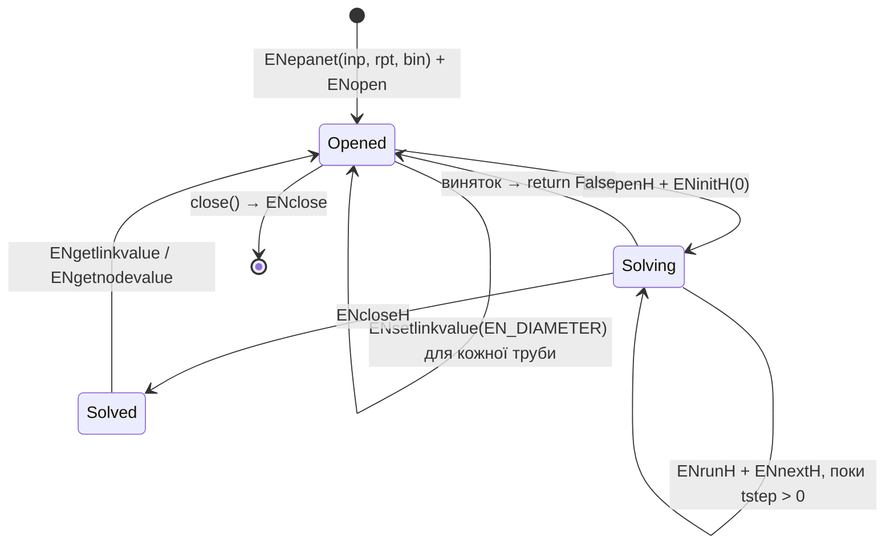
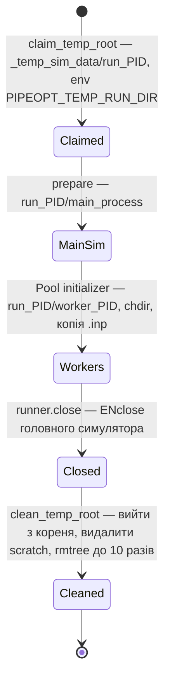

# PROJECT_MAP — GAPipeDiameterSearch (`pipeopt`)

> **Призначення.** Дати ШІ-агенту повну й точну модель коду — архітектуру, потоки
> даних, математику, контракти й приховані інваріанти — без перечитування всіх
> файлів. Мапа **не замінює** код: перед правкою відкрий файл за якорем.
>
> **Знімок:** commit `e0f520b` (гілка `refactor/stage-1`, коміт від 2026-09-18) +
> незакомічений `AUDIT_2026-09-21.md`. Мапу складено 2026-11-09.
> **При розбіжності правий код.**

**Легенда**

* `context.py:220` — файл:рядок на знімку. Імена файлів у `pipeopt/` унікальні
  (крім `__init__.py`), повні шляхи — у §2.2. Рядки зсуваються з кожним комітом —
  надійніший якір — ім'я символу (`SolverContext.score`).
* `[код]` — перевірено читанням коду; `[висновок]` — логічний висновок із коду,
  **не заміряний прогоном**; `[док]` — лише з `readme.md`/`AUDIT_*`/`RUNNING.md`;
  `[?]` — не перевірено.
* Константи наведено дослівно: `ІМ'Я = значення`. Неназвані числа в коді —
  «літерал».
* Позначки без дужок у таблицях означають `[код]`.

---

## Зміст

0. [Як користуватися мапою](#0-як-користуватися-мапою)
1. [Постановка задачі](#1-постановка-задачі)
2. [Архітектура](#2-архітектура)
3. [Глобальні інваріанти й контракти представлення](#3-глобальні-інваріанти-й-контракти-представлення)
4. [Потоки даних](#4-потоки-даних)
5. [Життєвий цикл прогону](#5-життєвий-цикл-прогону)
6. [Гідравлічний шар](#6-гідравлічний-шар)
7. [SolverContext, граф, каталог](#7-solvercontext-граф-каталог)
8. [Оцінювання й пам'яті](#8-оцінювання-й-памяті)
9. [Локальний пошук і стартові рішення](#9-локальний-пошук-і-стартові-рішення)
10. [Острів](#10-острів)
11. [Кіки](#11-кіки)
12. [Оркестрація й паралелізм](#12-оркестрація-й-паралелізм)
13. [Введення/виведення](#13-введеннявиведення)
14. [Відомі дефекти й свідомо збережені дивацтва](#14-відомі-дефекти-й-свідомо-збережені-дивацтва)
15. [Тести як специфікація](#15-тести-як-специфікація)
16. [Покажчик символів](#16-покажчик-символів)

---

## 0. Як користуватися мапою

### 0.1 Маршрути під типові задачі

| Задача | Читай | Обов'язково перевір |
|---|---|---|
| Будь-який рефакторинг солвера | §3.6 | порядок викликів RNG і промахів кешу = контракт еталона |
| Змінити правило прийняття кіка | §10.4, §10.5, §5.3 | §3.6; `test_apply_kick.py`, `test_acceptance.py` |
| Додати/змінити кік | §11, §3.3 (`KickResult`) | порожній кік мусить бути `failure` (`test_kick_failure_contract.py`) |
| Прискорити солвер | §3.5, §9.1, §9.6 | бюджет живе в `gradient_squeeze` (AUDIT §2.1 [док]) |
| Нова мережа / нова таблиця цін | §1.4, §3.1, §3.2, §13.2 | одиниці, EPS, насоси/засувки, порядок діаметрів |
| Міжострівний шар | §10.8, §12, §3.4 | еталон його **не бачить** (§3.6); `test_island_cooperation.py`, `reference_run.py --islands` |
| Звіти, GUI | §13 | порядок труб у графі ≠ порядок вектора (§3.1) |
| Скрипт у `experiments/` | §15.3 | стенди підміняють методи класів — імена методів є API |

### 0.2 Глосарій

| Термін | Значення | Де в коді |
|---|---|---|
| рішення, `indices`, `individual`, `sol` | `list[int]` довжини `n_pipes`; `x[i]` — індекс типорозміру труби `i` | скрізь |
| типорозмір, індекс діаметра `j` | позиція в таблиці цін, **відсортованій за діаметром** | `cost_table.py:85` |
| симуляція | один гідравлічний розрахунок EPANET | `water_sim.py:132` |
| `score` | штрафована оцінка всередині пошуку, **не** вартість (§8.1) | `context.py:220` |
| `dyn_bonus` | коефіцієнт премії за запас тиску, ≈0.001·вартість | `loop.py:173` |
| критичний вузол, `crit_node` | junction із найменшим тиском | `water_sim.py:175-182` |
| домінантний шлях | Dijkstra від джерел до `crit_node`, вага ребра `100/(j+1)` — шлях **найширших** труб, не гідравлічний | `context.py:271` |
| squeeze, поліровка, спуск | `LocalSearch.gradient_squeeze` | `local_search.py:181` |
| heal, лікування | `LocalSearch.heal_network` — підіймати труби на шляху, доки тиск не стане допустимим | `local_search.py:289` |
| кік | диверсифікаційний хід, 10 стратегій | `kick_registry.py:109` |
| острів, воркер | `IslandWorker` в окремому процесі | `island/loop.py:36` |
| промінь (beam) | `pool.active_pool` після відбору раунду | `beam.py:161` |
| раунд | одна ітерація `while` у `IslandWorker.run` | `loop.py:171` |
| застій | `stagnation_counter`; поріг `stag_limit` | `loop.py:80, 196` |
| температура відчаю `T` | `min(1, застій / (3·stag_limit))` | `state.py:59` |
| басейн, підпис басейну | грубе огрублення рішення (§8.4) | `pool.py:20` |
| привид (ghost) | рішення з «підозріло великим» виграшем, яке перевіряють на артефакт | `context.py:188` |
| рівень води | вердикт `POOL` — прийняти гірше рішення в пул | `acceptance.py:176` |
| `RECORD` / `ESCAPE` / `HAIL_MARY` / `REJECT` | вердикти кіка (§5.3) | `acceptance.py:37` |
| архів, `global_archive` | до 6 найкращих **різних** рішень островів | `orchestrator.py:156` |
| консенсус | труби, однакові в усьому архіві | `diversification.py:104` |
| авантюрист | останній воркер при `n_workers ≥ 4`, ігнорує сусідів до 85 % прогону | `exchange.py:75` |
| імунітет IPC | `ipc_immunity`: скільки раундів острів не слухає сусідів | `exchange.py:61` |
| мінірестарт | скидання пулу при глибокому застої | `beam.py:62` |
| μ (JADE) | адаптивний розмір кроку кіка | `adaptive_rates.py` |
| UCB1 / VND | бандит / випадковий вибір стратегії | `strategy_selector.py` |
| еталон | побітовий знімок 4 послідовних прогонів Ханої | `tools/reference_run.py` |
| клас мережі | `SMALL` < 50 ≤ `MEDIUM` < 200 ≤ `LARGE` < 1000 ≤ `XLARGE` труб | `context.py:17` |

---

## 1. Постановка задачі

### 1.1 Змінні рішення

* `x ∈ {0, …, K−1}ⁿ`, де `n = len(wn.pipe_name_list)` — **лише** лінки секції
  `[PIPES]` (насоси й засувки не є змінними), `K` — кількість рядків `costs.csv`.
* `x[i]` → діаметр `D[x[i]]`, де `D` — діаметри таблиці цін за зростанням (м).
* `max_d_idx = K − 1` (`context.py:123`).

### 1.2 Цільова функція задачі

```
C(x) = Σᵢ Lᵢ · price(D_raw[x[i]])             water_sim.py:121-122
```

* `Lᵢ` — довжина з `wntr` (SI, метри) (`water_sim.py:38`).
* `price` — ціна за одиницю довжини з `costs.csv` **як є** (`water_sim.py:89`).
  `[?]` Для мереж у US-одиницях (KL, GPM) довжина в метрах, а ціна, можливо, $/ft.
* Індекси перед підрахунком обрізаються до `[0, K−1]` (`np.clip`, `water_sim.py:121`)
  — вихід за межі не є помилкою (`test_out_of_range_indices_are_clamped_not_an_error`).
* У логах вартість друкується в M$ (`/1e6`).

### 1.3 Обмеження

```
P_min(x) = min_{j ∈ junctions} p_j(x)  ≥  h_min        water_sim.py:171-184
```

* Беруться лише junction-вузли (`wn.junction_name_list`), не резервуари й баки.
* `p_j` читається **після** повного циклу `ENrunH/ENnextH`, тобто на **останньому
  кроці часу** (§6.1). Для всіх мереж у `InputData/` крім LTown `Duration = 0`, тож
  це байдуже; для LTown (168 год) обмеження перевіряється лише в кінці тижня
  `[висновок]`.
* `p_max` рахується, але жодне рішення пошуку від нього не залежить.
* Обмежень швидкості, мінімального діаметра, телескопічності тощо **немає**
  (BOTTLENECK використовує «звуження вниз за течією» як евристику, не як обмеження).
* Збій розрахунку → `SimStats(cost, -1.0, -1.0, "ERR")` → недопустиме.

### 1.4 Score всередині пошуку (не плутати з `C(x)`)

```
surplus = p_min − h_min
score   = +∞                              якщо surplus < 0
        = cost                            політика "none"
        = cost − surplus · b              інакше,
          b = dyn_bonus · (0.2 якщо політика "damped" і surplus > 10 м)
```

`context.py:220-241`. Політика завжди `"damped"`: жоден виклик не передає
`surplus_bonus_policy` (`worker.py:332`, `orchestrator.py:40`) `[код]`. Деталі —
§8.1.

### 1.5 Чого в моделі **немає** (не шукай і не вигадуй)

* Зміни топології (структурної оптимізації): топологія фіксована з `.inp`.
* Моделей деградації, старіння, надійності, відмов, сценаріїв аварій.
* Найгіршого за часом тиску в EPS (лише останній крок, §1.3).
* Насосів і засувок у графі пошуку (§3.1): вони є в EPANET, але не в `base_G_flow`.
* Матриць інцидентності/суміжності як таких: є CSR-суміжність для numba (§7.1).
* Операційних витрат (енергія насосів) у цілі: лише капітальна вартість труб.
* Використання `InputData/*/min_p.txt` / `p_min.txt`: код їх **не читає** (grep).
* Генетичного алгоритму: назва репозиторію історична; `attic/` — старий GA-код, не
  імпортується пакетом.

---

## 2. Архітектура

### 2.1 Шари й напрям залежностей



Правило з `pipeopt/__init__.py`: `hydraulics` не знає про пошук; `solver` не знає
про звіти й UI; `reporting` не знає, як шукали; `ui` знає все. Солвер отримує
симулятор параметром (duck typing), тому тести підставляють `FakeSimulator`
(§15.2).

### 2.2 Модулі

| Файл | Рядків | Роль | Ключові символи |
|---|---:|---|---|
| `main.py` | 157 | CLI, `PYTHONHASHSEED`-перезапуск, лог прогону | `build_parser`, `apply_config_file`, `request_from_args`, `main` |
| `gui.py` | 572 | GUI, прогін у `threading.Thread` | `PipelineOptimizerApp` |
| `pipeopt/runner.py` | 410 | спільний сценарій CLI/GUI | `RunRequest`, `RunResult`, `OptimizationRunner` |
| `pipeopt/config.py` | 21 | конфіг задачі | `SolverConfig` |
| `pipeopt/console.py` | 90 | вивід | `DualLogger`, `silence_warnings`, `format_time` |
| `pipeopt/hydraulics/water_sim.py` | 207 | адаптер EPANET | `WaterSimulator` |
| `pipeopt/hydraulics/sim_stats.py` | 37 | результат розрахунку | `SimStats` |
| `pipeopt/solver/context.py` | 308 | граф, CSR, кеш, score, профіль мережі | `SolverContext`, `NetworkProfile`, `classify_network` |
| `pipeopt/solver/cache.py` | 18 | LRU | `LRUCache` |
| `pipeopt/solver/fast_math.py` | 67 | numba-ядра | `fast_dijkstra`, `fast_hamming_distance`, `fast_avg_hamming` |
| `pipeopt/solver/pool.py` | 55 | пул і табу | `SolutionPool` |
| `pipeopt/solver/local_search.py` | 424 | спуск, лікування, кандидати | `LocalSearch`, `DescentStats`, `ConstraintTightness` |
| `pipeopt/solver/seeds.py` | 108 | стартові рішення | `SeedFactory` |
| `pipeopt/solver/kick_registry.py` | 157 | контракт і реєстр кіків | `KickResult`, `KickArgs`, `KickSpec`, `KICK_REGISTRY`, `pool_for` |
| `pipeopt/solver/kick_memory.py` | 88 | коротка пам'ять кіків | `KickMemory` |
| `pipeopt/solver/kicks.py` | 30 | збирання домішок | `KickStrategies` |
| `pipeopt/solver/kicks_path.py` | 188 | SHOCK, BOTTLENECK, TOPO_INV | `PathKicks` |
| `pipeopt/solver/kicks_structural.py` | 212 | LOOP_BALANCE, ZERO_SUM, TRIM | `StructuralKicks` |
| `pipeopt/solver/kicks_ruin.py` | 204 | SMART_PERTURB, R&R, BASIN_ESCAPE, SPATIAL | `RuinKicks` |
| `pipeopt/solver/acceptance.py` | 183 | пороги й вердикт кіка | `AcceptancePolicy`, `Verdict` |
| `pipeopt/solver/strategy_selector.py` | 203 | UCB1/VND | `StrategySelector`, `Choice` |
| `pipeopt/solver/adaptive_rates.py` | 122 | JADE-кроки | `AdaptiveRates` |
| `pipeopt/solver/island/state.py` | 204 | температура, прогрес, пороги | `IslandState`, `AppliedKick` |
| `pipeopt/solver/island/beam.py` | 295 | мутації, промінь, аварійні гілки | `BeamSearch` |
| `pipeopt/solver/island/diversification.py` | 386 | сценарій кіка | `Diversification` |
| `pipeopt/solver/island/exchange.py` | 295 | IPC, порятунок, міграція | `IslandExchange` |
| `pipeopt/solver/island/loop.py` | 264 | головний цикл | `IslandWorker` |
| `pipeopt/solver/worker.py` | 352 | процес воркера, temp-каталоги | `run_island_worker`, `init_worker_process`, `WorkerTask`, `WorkerResult` |
| `pipeopt/solver/orchestrator.py` | 431 | острови, зведення, фінальна поліровка | `AnalyticalSolver`, `RunState` |
| `pipeopt/reporting/cost_table.py` | 125 | розбір `costs.csv` | `read_cost_table`, `load_cost_table`, `diameter_table` |
| `pipeopt/reporting/plot.py` | 278 | CSV/INP/звіт/графіки | `export_solution`, `plot_convergence`, `plot_network_map` |
| `pipeopt/reporting/netdraw.py` | 327 | малювання мережі | `NetworkGeometry`, `DiameterScale`, `draw`, `diameters_from_*` |
| `pipeopt/reporting/solution_table.py` | 94 | читання `solution.csv` | `diameter_column`, `is_index`, `real_diameter` |
| `pipeopt/ui/gui_results.py` | 353 | переглядач результатів | `ResultsViewer` |
| `pipeopt/ui/gui_widgets.py` | 134 | дрібні віджети | `GUIStream`, `load_dataframe` |
| `tools/reference_run.py` | 370 | еталон і перевірка островів | `CASES`, `run_case`, `island_check` |
| `tests/` | 49 файлів, ≈666 `def test_` | специфікація (§15) | `conftest.FakeSimulator` |
| `experiments/` | ≈20 скриптів + CSV замірів | стенди, підміняють методи (§15.3) | — |
| `attic/` | — | старий GA-код, не імпортується | — |

### 2.3 Склад класів



* **Домішки не мають `__init__`.** Усі поля острова створює
  `IslandWorker.__init__` (`loop.py:39-114`), а пишуть їх методи всіх чотирьох
  домішок через `self` (реєстр — §10.1). Те саме з `KickStrategies`
  (`kicks.py:28-30`: лише `ctx`, `ls`; `_cached_cycles` з'являється ліниво).
* Кратності: один `WaterSimulator` на процес; `SolverContext` — один на
  `AnalyticalSolver` (головний процес) **і** один на кожен виклик
  `run_island_worker` — у кожного свій кеш, лічильник і калібрування.
  У `--sequential` обидва контексти ділять **той самий** хендл EPANET.
* `AnalyticalSolver.pool` (`orchestrator.py:50`) створюється й ніде не читається
  (grep) — мертве поле.
* Диспетчер кіків викликає стратегію **за іменем методу** з реєстру:
  `getattr(self.kicker, spec.method)` (`diversification.py:302`). Перейменування
  методу кіка без правки `KICK_REGISTRY` ламає диспетчер тихо: виняток
  ловиться й логується (`diversification.py:304-306`).

---

## 3. Глобальні інваріанти й контракти представлення

### 3.1 Реєстр відображень індексів

| Простір | Що індексує | Звідки порядок | Де будується | Споживачі |
|---|---|---|---|---|
| `i` — труба | позиція у векторі рішення, у `lengths`, у виході `get_heuristics` | `wn.pipe_name_list` = порядок секції `[PIPES]` у `.inp` | `water_sim.py:35` | усе; звіти перечитують `.inp` і беруть той самий порядок (`plot.py:31`, `netdraw.pipe_order`) |
| `c_idx` труби | індекс лінка в EPANET | `ENgetlinkindex(name)` | `water_sim.py:60-63` | `_apply_pattern`, `get_heuristics`, `get_hydraulic_state` |
| `c_idx` вузла | індекс junction в EPANET | `ENgetnodeindex` по `wn.junction_name_list` | `water_sim.py:72-75` | `get_stats` → ім'я `crit_node` через `c_idx_to_node_name` |
| `j` — діаметр | рядок таблиці цін | `read_cost_table` **сортує за діаметром** | `cost_table.py:85` | `config.diameters_raw/_m`, `simulator.diams_m`, `simulator.costs`, `ctx.diameters`, звіти |
| `node_id` | вузол у CSR | порядок `base_G_flow.nodes()` (порядок вставки ребер) | `context.py:161-164` | `fast_dijkstra`, `source_ids` |
| ребро → труба | `edge_to_pipe[(u, v)]` і `[(v, u)]` → `i` | ітерація `simulator.graph.edges(keys=True)` | `context.py:152-159` | кіки, crossover, домінантний шлях |
| CSR-ребро → труба | `csr_edge_pipe[k]` паралельно до `csr_indices[k]` | обхід сусідів у порядку `node_id` | `context.py:168-180` | ваги Dijkstra `100/(x[csr_edge_pipe]+1)` |
| ребро малювання | `NetworkGeometry.edge_pipe_names` | порядок `wntr`-мультиграфа | `netdraw.py:66-100` | `diameters_from_*` мапить **за іменем труби** |

**Інваріанти й як вони ламаються**

1. **Узгодженість `j` тримається на сортуванні.** `ctx.diameters = sorted(available_diameters)`
   (`context.py:122`), але `simulator.diams_m = config.diameters_m` і
   `simulator.costs = [config.costs[d] for d in diameters_raw]` — **у порядку конфігу**
   (`water_sim.py:86-89`). Збігаються вони лише тому, що `read_cost_table` уже
   відсортував таблицю. Передати в `AnalyticalSolver` невідсортований список →
   `ctx.diameters[j] ≠ simulator.diams_m[j]` без жодної помилки `[висновок]`.
2. **Дублікати діаметрів у `costs.csv`** зливаються в `config.costs` (dict за діаметром)
   — ціна дубліката береться остання `[висновок]`.
3. **Граф пошуку містить лише труби.** `base_G_flow` додає ребро тільки якщо ключ
   ребра є в `comp_name_to_idx` (`context.py:153`), тобто насоси й засувки
   випадають. На LTown (1 насос, 3 засувки) граф може розпастися → `fast_dijkstra`
   повертає `[]` → `heal_network` повертає `ok=False`, path-кіки падають `[висновок]`.
4. **Паралельні труби** між тими самими вузлами в простому `nx.Graph` стають одним
   ребром; `edge_to_pipe[(u,v)]` зберігає **останню**, `node_to_pipes` — усі
   `[висновок]`. Чи є такі труби в `InputData/` — `[?]`.
5. **Джерела** = резервуари; баки — лише якщо резервуарів немає (`water_sim.py:68-70`).
   На LTown (2 резервуари + 1 бак) бак не є джерелом для Dijkstra.
6. **Зворотне відображення діаметрів у індекси** після прогону —
   `OptimizationRunner._indices_of` (`runner.py:258-267`): `table.index(d)` по
   float-ах; не знайдено → **тихо** максимальний індекс. Працює, бо солвер повертає
   рівно ті самі float-и з `ctx.diameters` (`orchestrator.py:126, 430`).
7. **`ctx.costs_array` — це `list`, не масив** (`= simulator.costs`, `context.py:183`);
   `numpy`-масив цін — `simulator.cost_array` (`water_sim.py:96`).

### 3.2 Одиниці вимірювання

| Величина | У `.inp` / EPANET | У Python | Конвертація | Ризик |
|---|---|---|---|---|
| Діаметр у таблиці цін | мм або дюйми (`--units`) | м (`config.diameters_m`) | `/1000` або `·0.0254` (`cost_table.py:112-117`) | `--units` описує **таблицю**, не `.inp` |
| Діаметр у EPANET | мм (SI) або in (US) за **flow units `.inp`** | м | `·1000` або `·39.3701` (`water_sim.py:52, 56, 127`) | розбіжність `--units` і `.inp` ловить лише preflight (§13.1) |
| Довжина | будь-які | м (wntr нормалізує) | — | — |
| Тиск | м (SI) або psi (US) | м | `·0.7032496` для US (`water_sim.py:53`) | — |
| Втрати напору | м або ft | м; `get_heuristics` → `hl/L` (м/м) | `·0.3048` для US (`water_sim.py:54`) | — |
| **Витрата** | CMH / LPS / GPM (з `.inp`) | **не конвертується** (`water_sim.py:198`) | — | `calculate_ideal_d` чекає м³/с → усі труби в максимум (§9.7, §14) |
| `h_min` | — | м (`--hmin`) | — | — |
| Швидкість | — | у солвері не рахується; лише у звіті через `wntr` (м/с) | — | — |

`is_us_units = flow_units < 5` (`water_sim.py:49`): коди EPANET 0–4 — CFS, GPM, MGD,
IMGD, AFD.

**Мережі в `InputData/`** (порахував за `.inp`/`.csv`):

| Мережа | труб | junctions | джерела | units | втрати | Duration | насоси/засувки | таблиця цін | клас |
|---|---:|---:|---|---|---|---|---|---|---|
| SimpleTest | 12 | 8 | 1R | LPS | H-W | — | 0/0 | 12 рядків, 32… | SMALL |
| Hanoi | 34 | 31 | 1R | **CMH** | H-W | 0 | 0/0 | 6 рядків, **дюйми** 12…40 → `--units in` | SMALL |
| Foss | 58 | 36 | 1R | LPS | H-W | 0 | 0/0 | 21, мм 16…, стовпець `ID` | MEDIUM |
| UTown | 72 | 48 | 1R | LPS | H-W | — | 0/0 | 12, 32… | MEDIUM |
| Balerma | 454 | 443 | 4R | LPS | **D-W** | 0 | 0/0 | 9, мм 113… | LARGE |
| Grid16x16 | 481 | 256 | 1R | LPS | H-W | 0 | 0/0 | 10, мм | LARGE |
| LTown | 905 | 782 | 2R+1T | CMH | H-W | **168 год** | **1/3** | 15, 50… | LARGE |
| Grid24x24 | 1105 | 576 | 1R | LPS | H-W | 0 | 0/0 | 10, мм | XLARGE |
| KL | 1274 | 935 | 1R | **GPM** | H-W | 0 | 0/0 | 10, 6.0… (`[?]` дюйми) | XLARGE |
| `EPANETINPUTFILESFOR7NEWORKS/*` | 7 еталонних `.inp` без таблиць цін | | | | | | | | |

`configs/Hanoi_1M.json` (`units: in`, 5 ядер, 1 млн) і `configs/balerma_15M.json`
(`units: mm`, `hmin: 20`, 15 млн). **Пастка:** CLI за замовчуванням бере Ханої з
`--units mm` (`main.py:26-30`), а таблиця Ханої в дюймах — прогін без `--units in`
зупиняє preflight (`RUNNING.md` [док], `runner.py:193-233` [код]).

### 3.3 Де-факто типи

```text
Solution     = list[int]                    # len n_pipes; 0..max_d_idx; приймаються й numpy-int
SimStats     = NamedTuple(cost, p_min, p_max, crit_node: str)   # crit_node == "ERR" ⇔ збій
               .simulation_ok · .is_feasible(h_min) · .surplus(h_min)       sim_stats.py:11-37
               розпаковується як кортеж: c, p, _, node = get_cached_stats(x)
Heuristics   = list[float]                  # hl/L по трубах; при збої — СУЦІЛЬНІ НУЛІ (water_sim.py:153)
FlowState    = (list[float], bool)          # витрати в одиницях .inp, feasible; вхід — діаметри В МЕТРАХ
PoolEntry    = tuple[float, float, Solution]   # (поле0, поле1, sol) — семантику полів див. нижче
ArchiveEntry = tuple[float, Solution]          # (cost, sol); global_archive, 'global_best', 'best_sol_{i}'
KickArgs     = dataclass (kick_registry.py:45)  # T, failed_pipes, boosted_pipes, zero_sum_tabu, current_round,
                                                # tabu_set, dyn_bonus, global_archive, max_perturb, mu_*_pct
KickResult   = dataclass (kick_registry.py:14)  # solution, locked, message, failed_pipe, path_signature, used_pct
               .failed ⇔ solution is None or locked is None
AppliedKick  = dataclass (state.py:16)      # strategy, use_bandit, result, solution, cost, score, round_idx
Verdict      = (kind, gap), порівнюється з рядком: verdict == Verdict.POOL     acceptance.py:37-63
Choice       = (strategy, mode_label, bandit_active)                          strategy_selector.py:27
WorkerTask   = frozen dataclass (worker.py:240); WorkerResult = NamedTuple(best_cost, best_solution, sim_count, basin_tabu)
RunRequest / RunResult (runner.py:51, 120); RunState(best_cost, best_sol, worker_sims) (orchestrator.py:21)
history      = list[(sims, cost)] у солвері → list[{"evals", "min_cost"}] у runner (runner.py:290-291)
```

**`PoolEntry`: поле 0 після вставки не читає ніхто.** Ось усі читання
`pool.active_pool` (grep): `x[1]` у `_initialize_seeds` (`beam.py:56`), `x[2]` у
`_generate_mutations`, `_emergency_pool_diversity`, `_pick_kick_target`,
`pool[0][2]`; сортування за полем 0 відбувається лише для `next_gen` і
`unique_next_pool` **до** того, як вони стають пулом (`loop.py:215`, `beam.py:218`).
Отже, «пріоритетні» значення поля 0 (`−1e6`, `−0.1·best`, `×1.05`, `×1.20`) на пошук
**не впливають**; значення має лише **позиція** (`insert(0, …)` робить запис ціллю
кіка при `round_idx % 3 == 1`) `[висновок]`.

| Хто кладе в пул | поле 0 | поле 1 | позиція |
|---|---|---|---|
| `_initialize_seeds` (`beam.py:37`) | `ctx.score` | cost | append |
| те саме, аварійне зерно (`beam.py:48`) | cost | cost | append |
| `_check_mini_restart` (`beam.py:99`) | `ctx.score` | cost | append |
| `_apply_swap` (`beam.py:124-125`) | `score − 0.1·run_best_cost` | cost | insert 0 |
| `_beam_search_and_update` (`beam.py:214, 220`) | `ctx.score` | cost | замінює пул |
| `_emergency_pool_diversity` (`beam.py:253`) | `ctx.score` | cost | замінює останній |
| `_emergency_respawn` (`beam.py:273, 284, 294`) | `cost − 1e6` | cost | append у порожній |
| `_accept_record` (`diversification.py:183`) | `kick.score` | `kick.cost` | insert 0 |
| `_accept_escape` (`:206`) | `kick.score` | `kick.cost` | пул = [це] |
| `_accept_into_pool` (`:225`) | `kick.score·1.05` | **ефективна** вартість (зі штрафом дефіциту) | append |
| `_accept_hail_mary` (`:256` / `:268`) | `q_c` / `kick.score·1.20` | `q_c` / ефективна | insert 0 / append |
| `_process_ipc` (`exchange.py:87`) | `ctx.score` | cost | append |
| `_check_rescue` (`exchange.py:111`) | `score − 1e6` | cost | insert 0 |
| `_migrate_soft` (`exchange.py:198`) | cost | cost | insert 0 |
| `_migrate_hybrid` (`exchange.py:226`) | cost | cost | insert 0 |

**Поле 1 теж не завжди справжня вартість**: після `POOL`/`HAIL_MARY` там може бути
`c + deficit·0.10·best` (§10.5), а рішення — недопустиме за тиском.

**Пул між раундами необмежений:** вставки накопичуються, і кожен запис стає
батьком у `_generate_mutations` наступного раунду — тобто кожна ін'єкція (IPC,
міграція, кік) подорожчує раунд. Обрізається пул лише в `_beam_search_and_update`
(`beam.py:219-220`).

### 3.4 Схема `shared_progress` (`multiprocessing.Manager().dict()`)

Існує лише в паралельному режимі; у `--sequential` це `None`, і весь шар обміну
мовчки вимкнений (§3.6).

| Ключ | Значення | Пише | Читає |
|---|---|---|---|
| `wid` (int) | спершу `0` (`orchestrator.py:396`), далі `{"round", "sims", "best_cost"}` | `run` щораунду **перезаписує** (`loop.py:179-182`); пінг під час спуску оновлює `sims` (`loop.py:153-167`, кожні >10 000 сим або >2 с); кінець `run` (`loop.py:229-233`) | `_live_snapshot` (`orchestrator.py:199-215`), підсумок `worker_sims` (`orchestrator.py:299-303`) |
| `'best_sol_{i}'` | `(cost, list)` | `_update_global_best` (`exchange.py:279-287`) | `_process_ipc`, `_pick_peer_solution`, `_live_snapshot`, `_adopt_best` |
| `'global_best'` | `(cost, list)` | `_update_global_best` (`exchange.py:289-295`): прочитати → порівняти → записати, **неатомарно** | `run` щораунду як `gb` (`loop.py:175`), `_live_snapshot`, `_adopt_best` |
| `'global_archive'` | `list[(cost, sol)]`, ≤ 6, без дублікатів | `_monitor_parallel` кожні `print_interval` с (`orchestrator.py:270-271`) | `_maybe_migrate` → `self.global_archive` (`exchange.py:142-144`) |

* Два воркери можуть перезаписати `global_best` гіршим значенням (гонка
  read-compare-write) `[висновок]`. На підсумок не впливає: `_adopt_best` бере
  мінімум по `global_best` **і** всіх `best_sol_{i}` (`orchestrator.py:334-343`).
* Записи йдуть через `_publish` / `_read_shared` (`exchange.py:21-58`), які ковтають
  `BrokenPipeError` тощо й логують. **Винятки:** `_process_ipc`, `run` (`loop.py:175`) і
  `_pick_peer_solution` читають `shared_progress.get(...)` напряму
  (`exchange.py:71, 171`).
* Гілка `'best_sol' in prog` у `_live_snapshot` (`orchestrator.py:206`) мертва:
  воркери цей ключ у свій словник не пишуть (grep) `[висновок]`.
* `global_archive` у `WorkerTask` завжди `[]` (`orchestrator.py:381, 408`);
  реальний архів острів бачить лише після першої міграції.

### 3.5 Облік бюджету симуляцій

| Виклик | Запускає EPANET? | Кеш | Лічиться в `ctx.sim_count` |
|---|---|---|---|
| `ctx.get_cached_stats` | при промаху | `sim_cache` (LRU 50 000) | **так**, лише промахи (`context.py:258`) |
| `ctx.is_ghost_solution` | при промаху | `sim_cache` | так (`context.py:198`) |
| `ctx.get_cached_heuristics` | при промаху (повна симуляція!) | `heuristic_cache` (LRU 50 000, окремий) | **ні** (`context.py:263-269`) |
| `simulator.get_hydraulic_state` (зерна) | так | ні | ні |
| `ctx._calibrate_simulator` | 13 (3 прогріву + 10 заміру) | ні | ні |
| `runner._preflight`, `runner._single_run` | по 1 | ні | ні |
| `export_solution` | 1 (окремий `wntr.sim.EpanetSimulator`) | — | ні |

* **`--max_sims` ≠ кількість викликів EPANET**: евристики, калібрування, зерна не
  лічаться `[висновок]`.
* **Зерна острова не входять у квоту**: `run_start_sims` фіксується **після**
  `make_diverse_seeds`/`make_reserve_pool` (`loop.py:123-134`), а
  `sims_used = sim_count − run_start_sims` (`loop.py:185`). У звіт (`ctx.sim_count`)
  вони потрапляють.
* Квота острова = `max_sims // n_workers` (`orchestrator.py:129-133`). Фінальна
  поліровка в головному процесі (`_final_polish`) квотою не обмежена.
* Підсумок прогону: `ctx.sim_count` головного процесу + `Σ` сим воркерів
  (`orchestrator.py:419`); у паралельному режимі `Σ` береться з `shared_progress`
  (`orchestrator.py:299-303`), у послідовному — з `WorkerResult.sim_count`
  (`orchestrator.py:310`).
* `max_sims = None` → `NetworkProfile.sim_budget` (`orchestrator.py:52-57`).
  `time_limit_sec = None` → `max_sims / (max(sim_speed, 1)·n_workers) · 5`
  (`orchestrator.py:59-63`); у `--sequential` без `--time_limit` → `inf`
  (`runner.py:106-116`).
* Де витрачається бюджет `[док]` (AUDIT §2.1): спуск 91–99.6 %, з них 77–81 % — поліровка
  кандидата в `evaluate_candidate`; `swap_search` 0–4.5 %; лікування 0.4–4.1 %; решта
  механізмів ≈0.1 %.

### 3.6 Відтворюваність і еталон

**Точки RNG** (усе — глобальний модуль `random`; `numpy.random` лише сіється, ніде не
використовується, grep):

| Де | Що |
|---|---|
| `main.py:103-109` | якщо задано `--seed` і `PYTHONHASHSEED != "0"` → `os.execv` того самого процесу з `PYTHONHASHSEED=0` (у PyInstaller-збірці — лише попередження) |
| `main.py:115-119` | `random.seed(seed)`, `np.random.seed(seed)` |
| `orchestrator.py:144` | `seed_modifier = random.randint(1, 10000)` — **місце в послідовності викликів значуще** |
| `worker.py:317-318` | `random.seed(task.seed)` з `task.seed = seed_modifier + worker_id` |
| `loop.py:173` | `random.uniform(0.95, 1.05)` щораунду для `dyn_bonus` |
| `local_search.py:231` | `random.shuffle(active_indices)` на кожному проході спуску |
| кіки, мінірестарт, crossover, VND, `_pick_kick_target` | `random.choice/sample/gauss/randint/shuffle` |

* `PYTHONHASHSEED` потрібен, бо є ітерація по множинах (наприклад `cluster_pipes`,
  `local_pipes`, `consensus`, `random.sample` по списках із множин). Без нього
  4 прогони з одним `--seed` дали 3 різні результати (`main.py:97-102` [док у коді]).
* Побітово відтворюваний **лише** `--sequential --seed N`: тоді один острів у тому ж
  процесі, `shared_progress = None`, часу немає (зупинка тільки за симуляціями).
* **Наслідок для мапи пошуку:** у послідовному режимі `global_archive` завжди `[]` →
  `BASIN_ESCAPE` недоступний, гарячий пул — `HOT_POOL_NO_ARCHIVE`, заморозки
  консенсусу немає, IPC/порятунку/міграції немає. Еталон **не перевіряє** цей шар.
* Еталон: `tools/reference_run.py` — 4 прогони Ханої з `--sequential --units in`
  (`CASES`, рядки 64-75): `analytical` seed 42/7 × 40k, seed 42 × 120k, `fast` seed 42.
  Порівнюються **вартість і кількість симуляцій**. Знімок `tests/reference_baseline.json`
  залежить від машини (`environment()`: версія Python, платформа, чи ввімкнений numba
  JIT). Docstring каже, що знімок «не комітиться», але файл **є** в git (`git ls-files`).
* **Метаінваріант:** будь-яка зміна кількості або порядку промахів `get_cached_stats` чи
  викликів RNG змінює прогін і ламає еталон. Саме тому `is_ghost`/`is_basin_tabu`
  передаються в `classify` лямбдами (`diversification.py:362-363`), а порядок
  мутацій у `_accept_*` збережено «дослівно».

### 3.7 Реєстр числових порогів

Пороги кіків — у картках §11.2. Тут — усе інше.

| Константа / літерал | Значення | Де | Роль |
|---|---|---|---|
| `SURPLUS_KNEE`, `SURPLUS_DAMPING` | 10.0 м, 0.2 | `context.py:13-14` | демпфування премії в `score` |
| `NETWORK_CLASS_BOUNDS` | (50 SMALL), (200 MEDIUM), (1000 LARGE), інакше XLARGE | `context.py:17` | клас мережі |
| `NetworkProfile.BEAM_WIDTH` | S 5, M 5, L 8, XL 8 | `context.py:50` | ширина променя |
| `NetworkProfile.SIM_BUDGET` | 1 млн, 3 млн, 3 млн, 30 млн | `context.py:55` | бюджет за замовчуванням |
| `NetworkProfile.PRINT_INTERVAL` | 1, 15, 30, 60 с | `context.py:59` | живий статус |
| `CANDIDATE_DIVISOR`, `XLARGE_CANDIDATES`, `MIN_CANDIDATES` | S 5, M 10, L 20; 10; 6 | `context.py:64-66` | старт `SINGLE_CANDIDATES = max(6, n // div)` |
| `DEEP_PASSES_LARGE/SMALL` | 8 / 5 | `context.py:69-70` | глибина поліру рекордного кандидата |
| `RESTART_PATIENCE_LARGE/SMALL` | 6 / 10 | `context.py:72-73` | множник порогу мінірестарту |
| кеші | 50 000 + 50 000 | `context.py:143-144` | LRU |
| допуск привида | 0.01 м | `context.py:193, 199` | `p < h_min − 0.01` |
| кошик відбитка | 50 (у грошах) | `context.py:249, 252` | `int(cost/50)·50` |
| вага домінантного шляху | `100/(j+1)` | `context.py:279` | Dijkstra |
| поріг периферії | `int(0.6·max_d_idx)` | `context.py:305` | TRIM |
| `dyn_bonus` | `0.001·min(run_best, global_best)·U(0.95, 1.05)` | `loop.py:173` | премія щораунду |
| `dyn_bonus` за замовчуванням | `0.001·cost(старт)` | `local_search.py:190-192` | якщо не передано |
| підпис басейну | точний при `n ≤ 50`, інакше середні по шматках `n // 25` | `pool.py:20-31` | §8.4 |
| `basin_tabu` | `deque(maxlen=500)` | `pool.py:11` | FIFO |
| tenure табу відбитків | 80 раундів | `pool.py:45` | |
| `RANKING_POLISH_PASSES` | 1 | `local_search.py:155` | поліровка кандидата |
| пороги `quick_mode` | втрати ≥ 0.10 (0.02 при запасі < 0.1 м) → пропуск; при тісному ще ≥ 0.005 | `local_search.py:240-252` | §9.1 |
| `min_rel_improvement` | 0.0003 за замовчуванням, перевірка кожні 3 проходи | `local_search.py:182, 224-229` | зупинка спуску |
| `ConstraintTightness.BANDS` | 0.05, 0.1, 0.25, 0.5, 1.0, 2.0, 5.0 м | `local_search.py:99` | лише замір |
| `IslandState.DEFAULT_MIGRATION_INTERVAL`, `MIN_…`, `LATE_MIGRATION_RATIO` | 15 000; 1 000; 0.8 | `state.py:53-57` | міграція |
| `COLD_TEMPERATURE` | 0.2 | `state.py:72` | заморозка консенсусу |
| `ROUND_BUDGET_SHARE`, `ROUND_SHRINK_STEP` | 0.04; 0.7 | `state.py:112, 118` | звуження раунду |
| `RECORD_RESET_FRACTION` | 0.005 | `state.py:171` | рекорд скидає застій |
| `GHOST_SUSPICION_FRACTION` | 0.02 | `state.py:175` | `_is_ghost_gain` |
| `MAX_PERTURB_FRACTION` | 0.50 | `state.py:178` | `KickArgs.max_perturb` |
| пізня фаза | `progress_ratio > 0.5` | `loop.py:194` | `is_late_game` |
| `stag_limit` | `max(4, int(12·(1 − progress)))` | `loop.py:196` | |
| кік | `stagnation_counter ≥ 2` | `loop.py:205` | |
| очищення `kick_tabu_set` | кожні 6 раундів | `loop.py:201` | |
| `ipc_immunity` на старті | 30 | `loop.py:91, 131` | |
| своп | кожні 8 раундів (`round_idx > 0`) | `beam.py:109` | |
| мутації за запасом батька | > 10 м → down 15, up `SINGLE_CANDIDATES`; < 2 м → 3, `SINGLE_CANDIDATES // 2`; інакше 8, `SINGLE_CANDIDATES` | `beam.py:137-139` | |
| фокус великих мереж | `top_k = max(20, n // 5)` | `beam.py:142` | |
| пари апгрейдів | перші 5 (3 при запасі < 2 м) high-friction, усі пари | `beam.py:154-158` | |
| різноманітність променя | `max_d = max(2, int(0.05·n))`, `min_dist = max(1, int(max_d·(1−p)³))` | `beam.py:164-165` | Хеммінг |
| поліровка променя | rank 0: 5 проходів, глибоко на парних раундах або після flush, 0.0005; rank 1–2: 3 швидкі, 0.002 | `beam.py:170-176` | |
| динамічний промінь | `max(3, int(BEAM_WIDTH·(1 + 0.5·(1 − p))))` | `beam.py:219` | |
| поріг різноманітності пулу | `max(1, int((n // 8)·(1 − p)))`, пул ≥ 3 | `beam.py:236-248` | заміна з резерву |
| мінірестарт | застій ≥ `stag_limit · mult`, `mult = restart_patience`, пізно `max(4, mult // 2)`; 4 зерна; збурення `n_perturb` | `beam.py:62-106` | §10.3 |
| час за замовчуванням | `max_sims / (sim_speed·n_workers) · 5` | `orchestrator.py:62-63` | |
| архів | ≤ 6 різних | `orchestrator.py:157` | |
| `fast_analytical` | поліруються TOP-5 зерен | `orchestrator.py:94` | |
| `AcceptancePolicy`, `StrategySelector`, `AdaptiveRates`, міграція | — | §10.5–10.8 | |

---

## 4. Потоки даних

### 4.1 Від вхідних файлів до звітів



Трансформації по стрілках:

| Крок | Вхід → вихід | Де |
|---|---|---|
| розбір таблиці | CSV → `(frame відсортований, diam_col, cost_col)` | `cost_table.py:66-85` |
| конфіг | `frame` → `diameters_raw` (як у файлі), `diameters_m` (м), `costs: {raw → ціна}` | `cost_table.py:103-125` |
| симулятор | `.inp` + конфіг → відкритий хендл, `component_names`, `lengths`, мапи індексів | `water_sim.py:21-81` |
| контекст | симулятор + `diameters_m` → граф, CSR, кеші, `profile`, `sim_speed` | `context.py:119-186` |
| рішення ↔ гідравліка | `Solution` → `SimStats` / `hl/L` / витрати | §6.2 |
| острів → оркестратор | `WorkerResult(best_cost, best_solution, sim_count, basin_tabu)` | `worker.py:263-269, 343` |
| солвер → runner | `list[float]` діаметрів у метрах (`ctx.diameters[x_i]`) | `orchestrator.py:428-431` |
| runner | діаметри → індекси (`_indices_of`) → **повторний** `get_stats` → `RunResult` | `runner.py:258-297` |
| звіти | індекси + `.inp` + конфіг → CSV/INP/TXT/PNG | §13.3 |

### 4.2 Що перетинає межу процесів

* `init_worker_process(inp_file, config)` — **шлях** до `.inp` і `SolverConfig` (pickle).
  Воркер копіює `.inp` у свій каталог і будує **власний** `WaterSimulator`
  (`worker.py:209-237`).
* `WorkerTask` (pickle): `diameters` (`ctx.diameters` головного процесу), `v_opt`,
  `time_budget`, `global_best_cost = inf`, `seed`, `worker_id`, `n_workers`,
  `max_sims` (квота), проксі `shared_progress`, `log_dir`, `global_archive = []`
  (`orchestrator.py:145-154`).
* Назад: `WorkerResult`; `basin_tabu` (deque) серіалізується, але оркестратор його
  **не використовує** (grep).
* Під час прогону: лише `shared_progress` (§3.4).

---

## 5. Життєвий цикл прогону

### 5.1 Послідовність запуску



* У `--sequential` пулу немає: `set_simulator(self.simulator)` (`runner.py:237-240`), і
  `run_island_worker` виконується в головному процесі (`orchestrator.py:304-314`) з
  `shared_progress = None`.
* **Зупинка з GUI:** `sync_ui_state` кидає `KeyboardInterrupt`, коли натиснуто
  «ЗУПИНИТИ» (`gui.py:420-423`). У `solve_standalone` його ловить `try` навколо
  островів (`orchestrator.py:400-413`) → «м'яка зупинка»: `_adopt_best` +
  `_final_polish` усе одно виконуються. У `solve_fast` виняток не ловиться →
  виходить у `runner.run` → `break` (`runner.py:318-321`).

### 5.2 Раунд острова



Порядок усередині раунду — `loop.py:171-227`. Прапорець `just_flushed` переходить між
раундами: `= rescue_fired` на початку (`loop.py:188`), `= True` після
`_force_flush_next` (ESCAPE) або `_emergency_respawn`, далі — результат
`_beam_search_and_update`. Він дозволяє недиверсних кандидатів у промінь
(`beam.py:183`) і вмикає глибоку поліровку лідера (`beam.py:171`).

### 5.3 Доля кіка: таблиця рішень

Умови перевіряються **по черзі** (`diversification.py:277-386`, `acceptance.py:164-183`);
`best = run_best_cost`, `T = effective_temperature` (0.5 в ablation).

| # | Умова | Результат | Стан, що змінюється |
|---:|---|---|---|
| 0 | виняток у методі кіка | лог, `return` | лише `tries` (уже збільшено в `pick`) |
| 1 | `res.failed` | відмова | `consecutive_fails += 1`; бандит ×0.25; для TOPO_INV «All paths tabu» → `kick_tabu_set.clear()` |
| 2 | недобір до лікування `> max(20, h_min·(1+T))` | безнадійний тиск | `consecutive_fails += 1` |
| 3 | `p < h_min − 0.5·T` і лікування не вдалось | `return` | нічого |
| 4 | після поліровки симуляція впала або недобір `> 0.5·T` | тихий `return` | нічого |
| 5 | `eff = c + deficit·0.10·best > best·(1.5 + 0.5·T)` | вибух вартості | бандит ×0.5; μ ×0.9 без підлоги |
| 6 | `deficit == 0`, `eff < best`, виграш `> 0.02·best`, `is_ghost()` | `GHOST_VETO` | нічого, **без** епілогу |
| 7 | `deficit == 0`, `eff < best` | `RECORD` | §10.4 `_accept_record` |
| 8 | `BASIN_ESCAPE` і `deficit == 0` | `ESCAPE` (навіть якщо `eff ≥ best`) | §10.4 `_accept_escape` |
| 9 | `eff < best·(1.03 + 0.07·T)` і басейн не в табу | `POOL(gap)` | §10.4 `_accept_into_pool` |
| 10 | `T ≥ 0.95` і басейн не в табу | `HAIL_MARY` | §10.4 `_accept_hail_mary` |
| 11 | інакше | `REJECT` | μ ×0.95 з підлогою |
| епілог (7–11) | `res.path_signature` → `kick_tabu_set`; `note_zero_sum` | | |

### 5.4 Критерії зупинки всіх рівнів

| Рівень | Умова | Де |
|---|---|---|
| серія прогонів | `runs` вичерпано; `should_stop()`; `KeyboardInterrupt` | `runner.py:306-321` |
| острівна модель | усі `AsyncResult.ready()`; або `KeyboardInterrupt` | `orchestrator.py:236-238, 411` |
| острів | `elapsed > time_budget` **або** `sims_used ≥ max_sims` — перевірка **раз на раунд**, тож перевищення можливе на ціну раунду (на Балермі ≈16 % бюджету, `state.py:109` [док у коді]) | `loop.py:184-186` |
| `gradient_squeeze` | прохід без прийнятого ходу; `passes > max_passes`; кожні 3 проходи відносний виграш `< min_rel_improvement` | `local_search.py:214-229` |
| `heal_network` | `p_min ≥ h_min` → ok; `crit_node` `ERR` / немає шляху / немає кандидатів → fail. **Ліміту ітерацій немає**: завершується, бо кожен крок +1 до індексу, а труби з максимумом не кандидати | `local_search.py:293-335` |
| свіп швидкостей у зернах | `new_idx == idx_sol` або 10 (5 у fast) ітерацій | `seeds.py:47-52, 68-73` |
| `fast_dijkstra` | ціль вийнята з черги або досяжних немає | `fast_math.py:35-44` |
| SPATIAL_PERTURB | набрано розмір, радіус 20 або граф перестав рости | `kicks_ruin.py:163-183` |
| `clean_temp_root` | до 10 спроб `rmtree` з паузою 0.5 с | `worker.py:182-190` |

---

## 6. Гідравлічний шар

### 6.1 Протокол хендла EPANET



* Хендл — **єдиний мутабельний стан процесу**: кожна симуляція перезаписує діаметри
  **всіх** труб (`_apply_pattern`, `water_sim.py:124-128`), тому порядок викликів
  кешу не впливає на результат, а сам хендл не можна ділити між потоками.
* Значення читаються **після** `ENcloseH` — це результати останнього кроку часу.
* Якщо `ENrunH` кидає виняток, `ENcloseH` не викликається (`water_sim.py:133-146`);
  чи коректний наступний `ENopenH` у такому стані — `[?]`.
* `.rpt`/`.bin` пишуться в `temp_dir` з PID у назві (`water_sim.py:40-41`); `temp_dir`
  обов'язковий (`test_the_temp_directory_is_required`).
* `close()` ідемпотентний; викликається явно (`runner.close`) і з `__del__`. На Windows
  без нього тимчасовий каталог не видаляється.

### 6.2 Контракти `WaterSimulator` (`water_sim.py`)

| Метод | Вхід | Виклики EPANET | Вихід | При збої | Лічиться |
|---|---|---|---|---|---|
| `__init__(inp_file, config, temp_dir)` | шляхи, `SolverConfig` | `ENopen`, `ENgetflowunits`, `ENgetlinkindex`×n, `ENgetnodeindex`×junctions | поля нижче | виняток назовні | — |
| `_refresh_config()` | — | — | `diams_m`, `costs` (list у порядку `diameters_raw`), `n_options`, `cost_array` | — | — |
| `_apply_pattern(x)` | `Solution` | `ENsetlinkvalue` × n | вартість `Σ L·cost_array[clip(x)]` | — | — |
| `_run_simulation_core()` | — | `ENopenH, ENinitH, (ENrunH, ENnextH)*, ENcloseH` | `bool` | `False` | — |
| `get_stats(x)` | `Solution` | apply + core + `ENgetnodevalue(EN_PRESSURE)` по junctions | `SimStats(cost, p_min, p_max, crit_node)` | `SimStats(cost, -1, -1, "ERR")` | через `ctx` |
| `get_heuristics(x)` | `Solution` | apply + core + `ENgetlinkvalue(EN_HEADLOSS)` | `list[hl/L]` (м/м; 0 при `L = 0`) | `[0.0]·n` — **тихо** | **ні** |
| `get_hydraulic_state(d)` | **діаметри в метрах**, не індекси | `ENsetlinkvalue`, core, `EN_FLOW`, `EN_PRESSURE` | `(flows в одиницях .inp, p_min ≥ h_min)` | `([0.0]·n, False)` | ні |
| `close()` | — | `ENclose` | — | ковтає винятки | — |

Поля після `__init__`: `wn` (wntr-модель), `graph = wn.to_graph()` (MultiGraph із
ключами-іменами лінків), `component_names`, `n_variables`, `lengths` (np), `api`,
`is_us_units`, `diam_epanet_mult`, `press_si_mult`, `hl_si_mult`,
`pipe_name_to_c_idx`, `junction_c_indices`, `c_idx_to_node_name`, `sources`,
`diams_m`, `costs`, `n_options`, `cost_array`. Коди EN: `EN_DIAMETER = 0`,
`EN_FLOW = 8`, `EN_HEADLOSS = 10`, `EN_PRESSURE = 11` (`water_sim.py:13-18`);
`EN_JUNCTION` і `EN_LENGTH` оголошені, не використовуються.

`warnings.filterwarnings("ignore")` на рівні модуля (`water_sim.py:10`) — імпорт
симулятора глушить **усі** попередження процесу.

### 6.3 `SimStats` (`sim_stats.py:11-37`)

`NamedTuple(cost, p_min, p_max, crit_node)`; `simulation_ok ⇔ crit_node != "ERR"`;
`is_feasible(h) ⇔ ok ∧ p_min ≥ h`; `surplus(h) = p_min − h`. Третій елемент — це
**максимальний тиск**, не ознака допустимості (історичне джерело помилок).

---

## 7. SolverContext, граф, каталог

### 7.1 Побудова (`SolverContext.__init__`, `context.py:119-186`)

1. `diameters = sorted(available_diameters)`; `max_d_idx = len − 1`; `v_opt` зберігається
   (ніде не читається); `num_pipes = simulator.n_variables`;
   `profile = NetworkProfile(num_pipes)`; `h_min = simulator.config.h_min`.
2. `surplus_bonus_policy` ∈ `("damped", "undamped", "none")`, інакше `ValueError`.
3. `comp_name_to_idx = {ім'я труби: i}`; два `LRUCache(50000)`; `sim_count = 0`.
4. Для кожного ребра `(u, v, key)` мультиграфа wntr, якщо `key` — труба:
   `base_G_flow.add_edge(u, v)` (без атрибутів!), `edge_to_pipe[(u,v)] = edge_to_pipe[(v,u)] = i`,
   `node_to_pipes[u|v].append(i)`.
5. `nodes_list`, `node_to_id`, `id_to_node`, `num_nodes`;
   `source_ids` = джерела симулятора, присутні в графі (`int32`).
6. CSR: для кожного `node_id` по сусідах `base_G_flow` → `csr_indptr`, `csr_indices`,
   `csr_edge_pipe` (`int32`).
7. `lengths = simulator.lengths`; `costs_array = simulator.costs` (list).
8. `sim_speed = _calibrate_simulator()` і друк `[SolverContext] Hardware calibrated`.

### 7.2 Картки методів

#### `SolverContext.get_dominant_path(indices, crit_node) → (pipes, nodes)` · `context.py:271-298`

* `weights = 100 / (indices[csr_edge_pipe] + 1)` — ширша труба = коротше ребро.
* `fast_dijkstra(num_nodes, source_ids, target, csr…)` — багатоджерельний Dijkstra,
  **O(V²)** вибором мінімуму без купи (`fast_math.py:26-67`); зупинка, щойно ціль вийнята;
  шлях відновлюється до першого вузла з `dist == 0` (джерела).
* Повертає `path_pipes` (від джерела до `crit_node`) і вузли; `([], [])`, якщо вузла немає
  в графі, шлях порожній або **будь-який** виняток (ковтається).
* Це **не** гідравлічний шлях: він не залежить від витрат і втрат.

#### `SolverContext.get_lazy_periphery(indices) → (indices, periphery)` · `context.py:300-308`

Труби **не** на домінантному шляху з `x_i ≤ int(0.6·max_d_idx)`, відсортовані за
зростанням питомих втрат. Повертає вхідний `indices` без копії. `crit_node == "ERR"` →
`(indices, [])`. Використовує TRIM.

#### `SolverContext.is_ghost_solution(indices) → bool` · `context.py:188-202`

* Кеш-хіт → `p_min < h_min − 0.01`, **без** нової симуляції. Промах → `get_stats`,
  у кеш, `sim_count += 1`. Виняток → лог і `True`.
* **У всіх трьох місцях виклику рішення щойно оцінене через `get_cached_stats`**
  (`beam.py:111, 185`, `diversification.py:336`) і `deficit == 0`, тож перевірка
  читає кеш і повертає `False`: щит від ілюзій за побудовою не спрацьовує, поки
  запис не витіснено з LRU `[висновок]`. Узгоджується із заміром «за 13 зерен не
  стріляв» (AUDIT_2026-09-21 §6 [док]) і з ablation «побітово той самий прогін»
  (AUDIT §2.2 [док]).

#### `SolverContext.get_fingerprint(indices, known_cost=None)` · `context.py:246-252`

`(int(cost/50)·50, tuple(indices))`. Кошик вартості надлишковий: кортеж і так
однозначний. Без `known_cost` — бере вартість із кешу (може запустити симуляцію).

#### `SolverContext._calibrate_simulator() → sims/s` · `context.py:204-218`

3 прогріви + 10 заміряних `get_stats` **напряму** (повз кеш і лічильник) на рішенні
«усі середні» зі зниженою трубою `i % n`. Результат залежить від завантаження машини і
впливає на: `time_limit_sec` за замовчуванням, `round_cost_limit` при необмеженому
бюджеті симуляцій.

#### `get_cached_stats` / `get_cached_heuristics` · `context.py:254-269`

Ключ — `tuple(indices)`. Окремі кеші ⇒ нове рішення, якому потрібні і тиск, і втрати,
коштує **дві** симуляції, з яких лічиться одна.

### 7.3 `NetworkProfile` (`context.py:34-115`)

| Властивість | S / M / L / XL | Хто читає |
|---|---|---|
| `name` | за `classify_network(n)` | `ctx.profile.name` |
| `is_large` | `name ∈ {LARGE, XLARGE}` (≥ 200 труб) | `heal_network`, `swap_search`, `_generate_mutations` |
| `beam_width` | 5 / 5 / 8 / 8 | `worker.py:338` (через `beam_width_for(classify_network(n))`) |
| `sim_budget` | 1M / 3M / 3M / 30M | `orchestrator.py:52` |
| `print_interval` | 1 / 15 / 30 / 60 с | `orchestrator.py:233` |
| `single_candidates` | `max(6, n//5)`, `max(6, n//10)`, `max(6, n//20)`, 10 | `loop.py:74` — лише **старт**; далі `narrow_round` |
| `MIN_CANDIDATES` | 6 | `state.py:146` — підлога звуження |
| `deep_polish_passes` | 5 / 5 / 8 / 8 | `AcceptancePolicy.deep_passes` |
| `restart_patience` | 10 / 10 / 6 / 6 | `beam.py:63` |

Поза профілем лишилась ще одна копія меж класів: `cutoff` у R&R —
`3 if n < 50 else 4 if n < 200 else 6 if n < 1000 else 8` (`kicks_ruin.py:65`).

---

## 8. Оцінювання й пам'яті

### 8.1 `SolverContext.score(cost, p_min, dyn_bonus)` · `context.py:220-241`

```text
surplus = p_min − h_min
if surplus < 0:                     return +inf          # обмеження = смертельний штраф
if policy == "none":                return cost
if policy == "damped" and surplus > SURPLUS_KNEE (10 м):
    dyn_bonus *= SURPLUS_DAMPING (0.2)                   # демпфується ВСЯ премія
return cost − surplus · dyn_bonus
```

* **Розрив у точці 10 м:** премія падає з `10·b` до `≈2·b` — score стрибком гіршає
  `[висновок]`. Замір у docstring: 82 % викликів мають запас < 1 м, 0.26 % — понад 10 м
  [док у коді].
* Score **не масштабно-інваріантний** між викликами: `dyn_bonus` різний у різних місцях.

| Звідки `dyn_bonus` | Значення | Де |
|---|---|---|
| острів, до зерен | `0.001·min(найкраще зерно, global_best_cost)` | `loop.py:126-127` |
| острів, щораунду | `0.001·min(run_best_cost, global_best_cost)·U(0.95, 1.05)` | `loop.py:173` |
| `gradient_squeeze` без аргументу | `0.001·cost(старт)` | `local_search.py:190-192` |
| `solve_fast` | `0.001·raw_cost` | `orchestrator.py:101` |
| `_final_polish` | `0.001·best_cost` | `orchestrator.py:351` |
| кіки | `KickArgs.dyn_bonus = base_dyn_bonus` | `diversification.py:79` |

Для недопустимого, але «терпимого» результату кіка score — це **ефективна вартість**
без премії (`diversification.py:354-355`).

### 8.2 Кеші

`LRUCache(maxsize)` на `OrderedDict` (`cache.py`); `get` переміщує в кінець, `set`
витісняє найстаріший. Два екземпляри на контекст (§7.2). Обидва переживають раунди й
мінірестарти; не очищаються ніколи.

### 8.3 Табу й пам'яті

| Пам'ять | Ключ → значення | Тривалість | Пише | Читає | Очищає |
|---|---|---|---|---|---|
| `pool.tabu_fingerprints` | відбиток → раунд | 80 раундів | `add_to_tabu`: `_initialize_seeds`, `_beam_search_and_update` | `is_tabu` у промені | `_check_mini_restart`, `_emergency_respawn`, `clear_all` |
| `pool.kick_tabu_set` | `path_signature` (відсортовані труби шляху) | до очищення | епілог `_apply_kick` | TOPO_INV через `args.tabu_set` | кожні 6 раундів; рекорд/flush і кожен 8-й застій у промені; успішний своп; порятунок; мінірестарт; респаун; TOPO_INV «All paths tabu» |
| `pool.basin_tabu` | підпис басейну | FIFO 500 | `_polish_kicked` для BASIN_ESCAPE — підпис **поточного рекорду**, який покидаємо | `classify` (POOL/HAIL_MARY), мінірестарт, `_process_ipc` | лише `clear_all` на старті `run` |
| `KickMemory.bottleneck_failed` | труба → раунд | 10 раундів | **ніхто** `[висновок]` | BOTTLENECK | ESCAPE |
| `KickMemory.loop_balance_failed` | труба → раунд | `min(80, max(3, n//5))` | **ніхто** `[висновок]` | LOOP_BALANCE і всі інші стратегії, крім BOTTLENECK | ESCAPE |
| `KickMemory.bottleneck_boosted` | труба → раунд | 5 раундів | `_accept_into_pool` → `note_boost` (лише BOTTLENECK, лише вердикт POOL) | BOTTLENECK | ESCAPE |
| `KickMemory.zero_sum_tabu` | труба → раунд | 15 раундів | епілог `note_zero_sum`: `next(iter(locked))` — перший елемент **множини** | ZERO_SUM | ESCAPE |

**Пам'ять невдач порожня завжди** `[висновок]`: `_note_kick_failure` пише в неї лише
`res.failed_pipe` **невдалого** результату (`diversification.py:88-89`), а жоден
`KickResult.failure(...)` у `kicks_*.py` не передає `failed_pipe` (grep: `failed_pipe=`
трапляється лише в **успішних** результатах BOTTLENECK і LOOP_BALANCE). Тобто перевірки
`failed_pipes` у BOTTLENECK і LOOP_BALANCE ніколи не відсікають труб. Назва поля
`failed_pipe` в успішних результатах означає «труба, з якою кік працював».

`next(iter(locked))` для ZERO_SUM — це не обов'язково піднята труба: порядок множини
малих int визначається хешем `[висновок]`.

### 8.4 Підпис басейну (`SolutionPool.get_basin_signature`, `pool.py:20-31`)

* `n ≤ 50` → `tuple(indices)` (точне рішення).
* Інакше → рішення ріжеться на шматки по `max(1, n // 25)` **сусідніх за номером** труб,
  і з кожного береться `round(mean)`. Сусідство — за порядком `[PIPES]` у `.inp`, **не**
  просторове: зміст «басейну» залежить від нумерації мережі `[висновок]`.

`hamming_distance` — numba `fast_hamming_distance` після приведення до `int32`.

---

## 9. Локальний пошук і стартові рішення

Формат карток: шапка — сигнатура й якір; таблиця «вхід/вихід/стан/симуляції»;
псевдокод із константами; інваріанти.

### 9.1 `LocalSearch.gradient_squeeze(indices, locked_pipes=None, max_passes=None, quick_mode=False, dyn_bonus=None, min_rel_improvement=0.0003, classical_descent=False) → Solution` · `local_search.py:181-287`

| | |
|---|---|
| Роль | Жадібний покоординатний спуск по індексах діаметрів; **споживач 91–99.6 % бюджету** [док] |
| Вхід | рішення (не мутується — копія), замки (труби, яких не чіпати), режим |
| Вихід | нове рішення (той самий або кращий score; допустимість зберігається, якщо старт допустимий) |
| Читає | `ctx` (кеші, `h_min`, `max_d_idx`), `self.progress_callback` (атрибут, який **острів чіпляє ззовні**, `loop.py:169`) |
| Пише | `self.stats` (`DescentStats`); через `progress_callback` — `shared_progress` |
| Симуляції | quick: ≤ 1 на перевірену трубу + 1 евристика на прохід; повний: ≤ 2 на трубу |
| RNG | `random.shuffle` на кожному проході |

```text
if dyn_bonus is None: dyn_bonus = 0.001 · cost(indices)
if classical_descent: quick=False, max_passes=None, min_rel=0, locked=∅   # лише для стендів
cur = list(indices); passes = 0
cost, p = stats(cur); best_score = score(cost, p, dyn_bonus)
milestone_cost = cost; milestone_pass = 0
active = [i for i in range(n) if i ∉ locked]
improved = True
while improved:
    improved = False; passes += 1; stats.start_pass()
    progress_callback()                                  # якщо задано
    if max_passes and passes > max_passes: break         # 0 і None = без обмеження
    if passes − milestone_pass ≥ 3:
        if (milestone_cost − cost) / max(milestone_cost, 1) < min_rel: break
        milestone_cost, milestone_pass = cost, passes
    shuffle(active)
    ul = heuristics(cur) if quick else None              # ОДИН раз на прохід — застаріває всередині проходу
    tight = (p − h_min) < 0.1                            # теж раз на прохід
    for i in active:
        if quick and (ul[i] ≥ (0.02 if tight else 0.10) or (tight and ul[i] ≥ 0.005)): skip
        try x_i − 1 (якщо x_i > 0):  feasible ∧ (score < best  ∨  quick ∧ c < cost) → кандидат
        try x_i + 1 (якщо x_i < max і НЕ quick): feasible ∧ score < кращого → кандидат
        кандидат є → cur = кандидат; best_score, cost, p = …; improved = True
    stats.finish_pass()
return cur
```

**Інваріанти й тонкощі**

* Хід приймається **одразу** для кожної труби (first-improvement у випадковому порядку),
  а не найкращий за прохід.
* `quick_mode` пробує **лише пониження** і приймає його за **вартістю**, навіть коли
  score гірший (рядок 267). За монотонних цін це означає «будь-яке допустиме
  пониження труби з малими втратами». Фактичний поріг пропуску в тісному режимі —
  `ul ≥ 0.005`.
* Повний режим (`quick_mode=False`) пробує обидва напрямки й приймає лише кращий score.
* `DescentStats.passes` рахує і прохід, перерваний `max_passes` (`start_pass` до `break`).
* Допустимість не порушується: кожен прийнятий хід має `p ≥ h_min`. Якщо старт
  недопустимий (`best_score = inf`), спуск може лише знайти допустиме пониження — у
  quick-режимі це практично неможливо `[висновок]`.
* Тести: `test_gradient_squeeze_*` (`test_local_search.py`), `test_polish_depth.py`,
  `test_descent_stats.py`, `test_epsilon_window.py`.

**Хто кличе й з якими параметрами** (grep, повний перелік)

| Виклик | `max_passes` | `quick` | `min_rel` | замки | `dyn_bonus` |
|---|---|---|---|---|---|
| `evaluate_candidate` (`local_search.py:414`) | `RANKING_POLISH_PASSES = 1` | так | 0.0003 | підняті труби | острова |
| промінь, rank 0 (`beam.py:172`) | 5 | ні на парних раундах і після flush, інакше так | 0.0005 | — | острова |
| промінь, rank 1–2 (`beam.py:174`) | 3 | так | 0.002 | — | острова |
| мінірестарт (`beam.py:89`) | 2 | так | 0.0003 | — | острова |
| `_polish_kicked`, швидко (`diversification.py:153`) | `max(1, 2 − int(2T))` | так | 0.0003 | замки кіка, крім UNLOCKED | острова |
| `_polish_kicked`, глибоко (`diversification.py:169`) | `deep_passes(gap, T)` | `gap ≥ 0` | 0.0003 | замки + консенсус | острова |
| `_accept_hail_mary` (`diversification.py:248`) | 1 | так | 0.0003 | — | острова |
| LOOP_BALANCE (`kicks_structural.py:73`) | 2 | так | 0.0003 | замки кіка | `args.dyn_bonus` |
| `solve_fast` (`orchestrator.py:101`) | `None` | ні | 0.0003 | — | `0.001·raw_cost` |
| `_final_polish` (`orchestrator.py:349`) | `None` | ні | 0.0003 | — | `0.001·best_cost` |
| `make_reserve_pool` (`seeds.py:39`) | 2 | так | 0.0003 | випадкові `max(3, n//4)` | за замовчуванням |
| `make_diverse_seeds` (`seeds.py:58`) | 12 | так | 0.0003 | — | за замовчуванням |
| `make_diverse_seeds_for_fast` (`seeds.py:80`) | 2 | так | 0.0003 | — | за замовчуванням |
| `make_backbone_seed` (`seeds.py:107`) | 2 | так | 0.0003 | — | за замовчуванням |

### 9.2 `LocalSearch.heal_network(kicked, locked_pipes) → (Solution, ok, boosts)` · `local_search.py:289-335`

| | |
|---|---|
| Роль | Відновити допустимість, піднімаючи по одній трубі на домінантному шляху |
| Вхід | **мутується на місці** (`kicked[best] += 1`, рядок 331) і повертається той самий об'єкт |
| Симуляції | на ітерацію: 1 тиск + 1 евристика (обидві — промахи, бо рішення нове) |
| Межа | ліміту ітерацій **немає**; гірший випадок ≈ `n·K` ітерацій |

```text
loop:
    _, p, _, crit = stats(kicked)
    if p ≥ h_min:              return kicked, True,  boosts
    if crit ∈ {"", "ERR"}:     return kicked, False, boosts
    path = dominant_path(kicked, crit);  if not path: return kicked, False, boosts
    ul = heuristics(kicked)
    cand = [(i, eff_i) for i in path if i ∉ locked and x_i < max]
        LARGE/XLARGE: Δc = costs[x_i+1] − costs[x_i];  eff_i = ul_i / max(1e-6, Δc·√max(1, Δc·L_i))
        інакше:       eff_i = ul_i
    if not cand: break → return kicked, False, boosts
    kicked[argmax eff] += 1;  boosts += 1
```

* Повідомлення «Heal Aborted Early: Cost exceeded limit» (`diversification.py:328`)
  **не відповідає коду**: обмеження вартості в лікуванні немає.
* Єдиний виклик, де мутація шкодить: `FINAL GUARD` передає **сам**
  `self.run_best_sol` (`loop.py:257`) — при невдачі вектор лишається частково
  піднятим, а вартість стає `inf` `[висновок]`. Решта 16 викликів передають свіжі копії.
* Тести: `test_heal_network_*` (`test_local_search.py`).

### 9.3 `LocalSearch.evaluate_candidate(base, pipes_to_mod, mode, dyn_bonus) → (score, cost, sol | None)` · `local_search.py:398-424`

```text
test = list(base); locked = ∅
for p in pipes_to_mod:
    "upgrade"   and x_p < max: x_p += 1; locked.add(p)
    "downgrade" and x_p > 0:   x_p −= 1                  # пониження НЕ блокується
nothing changed → (inf, −inf, None)
sq = gradient_squeeze(test, locked, max_passes=1, quick=True, dyn_bonus)
cost, p = stats(sq);  tightness.note(p − h_min)          # замір без симуляцій
p < h_min → (inf, −inf, None)                            # ремонту немає — кандидат просто відкидається
return (score(cost, p, dyn_bonus), cost, sq)
```

* Через цю функцію проходить 77–81 % бюджету [док, AUDIT §2.1].
* Кандидати, що дійшли до променя, допустимі **за побудовою** (`test_epsilon_window.py`).

### 9.4 `LocalSearch.swap_search(indices, dyn_bonus) → Solution` · `local_search.py:337-396`

Кличеться лише з `_apply_swap` кожні 8 раундів для `run_best_sol`.

```text
copy; raw, p, crit = stats; crit ERR → return
best = score(raw, p);  path = dominant_path;  ul = heuristics;  lazy = argsort(ul) ↑
down_limit = max(10, n // 3);  LARGE/XLARGE: min(down_limit, 40)
if (p − h_min) ≥ 0.02:                                   # не критично тісно
    for q in lazy[:down_limit]: if x_q > 0 and ul_q < 0.05: try x_q − 1; кращий score → прийняти
if not LARGE/XLARGE:
    for up in path[-15:]:  for (d1, d2) in combinations(lazy[:20], 2):
        try (+1 up, −1 d1, −1 d2); feasible ∧ кращий score → прийняти
return copy
```

* До 15 · 190 = 2 850 симуляцій на виклик на малих мережах. AUDIT §3.3 [док]:
  «працює здебільшого вхолосту»; ablation — +0.04 %, p = 0.5.
* `d1`/`d2` можуть збігтися з `up` (тоді зміни взаємно гасяться) `[висновок]`.

### 9.5 `LocalSearch.get_high_impact_pipes(indices, top_k)` · `local_search.py:164-179`

`impact_i = L_i·(costs[x_i] − costs[x_i − 1]) · (1 + max(ul_i, 1e-5))` (0 при `x_i = 0`);
повертає `top_k` за спаданням. Використовує лише `_generate_mutations` на великих мережах.

### 9.6 Лічильники без впливу на пошук

* `DescentStats` (`local_search.py:6-65`): `passes`, `scanned`, `skipped`, `accepted`,
  `last_pass_yield`, `yield_rate`. Поведінки не змінює (задумано для правила зупинки
  §23.2 плану).
* `ConstraintTightness` (`local_search.py:68-142`): частка недопустимих кандидатів і
  гістограма недобору за `BANDS`; друкується як `[TIGHTNESS]` у кінці `run`
  (`loop.py:242-252`).

### 9.7 `SeedFactory` (`seeds.py`)

| Метод | Алгоритм | Симуляції | Де кличеться |
|---|---|---|---|
| `calculate_ideal_d(flow, v)` | `abs(q) < 1e-6 → 0`; `d = √(4·abs(q)/(πv))`; `bisect_left(diameters, d)`, за межею — `max_d_idx` | 0 | зерна |
| `make_diverse_seeds()` | для `v ∈ [1.0, 1.2, 0.8]`: старт «усі максимальні»; ≤ 10 ітерацій `flows → ideal_d`; недопустиме → `heal`, невдача → пропуск; `squeeze(12, quick)` | `get_hydraulic_state` (не лічиться) + спуск | `IslandWorker.run` |
| `make_reserve_pool(size=4)` | випадкове рішення → `heal` → заморозити випадкові `max(3, n//4)` → `squeeze(2, quick)` | лікування випадкового старту — дороге на великих мережах | `IslandWorker.run` |
| `make_diverse_seeds_for_fast()` | те саме для 16 швидкостей `0.5…2.0`, ≤ 5 ітерацій, `squeeze(2)` | | `solve_fast` |
| `make_backbone_seed(v)` | витрати при «усі максимальні»; топ-20 % за `abs(q)` → максимум, нижні 50 % → 0, середина → `ideal_d`; `heal`; `squeeze(2)`; `None` при невдачі | | `solve_fast`, `v ∈ [0.8, 1.0, 1.2, 1.5, 1.8]` |

**Дефект одиниць** (AUDIT §3.1 [док], `[код]` підтверджено): витрата приходить в
одиницях `.inp` (CMH/LPS/GPM), а формула чекає м³/с → `d` у 1000–3600 разів завеликий
→ `ideal_d = max_d_idx` для **кожної** труби. Наслідки: усі зерна `make_diverse_seeds`
стартують з «усі максимальні» й різняться лише порядком спуску; 16 зерен fast-режиму —
копії; у backbone середня частина — максимум; `--v_opt` ні на що не впливає (його й так
ніхто не читає: `ctx.v_opt` лише зберігається).

---

## 10. Острів

`IslandWorker(IslandState, IslandExchange, Diversification, BeamSearch)` (`loop.py:36`).
Один об'єкт на виклик `run_island_worker`; домішки ділять поля через `self`.

### 10.1 Реєстр полів стану

| Поле | Init (`loop.py`) | Пишуть | Читають |
|---|---|---|---|
| `ctx`, `kicker`, `ls`, `worker_id`, `n_workers`, `max_sims` (квота острова) | 43-48 | — | скрізь |
| `BEAM_WIDTH` | 49, з `profile.beam_width` | — (велика літера, але **параметр**) | `_beam_search_and_update` |
| `global_archive` | 50, з `WorkerTask` (`[]`) | `_maybe_migrate` (`exchange.py:144`) | `pool_for`, `_build_kick_args`, `_consensus_locks` |
| `pool` | 52 | §3.3, §8.3 | |
| `seeder`, `_is_tree` (`nx.is_tree(base_G_flow)`) | 53, 57 | — | `run`, `pool_for` |
| `ablation`, `selector`, `acceptance` | 67-69 | — | `_apply_kick` |
| `SINGLE_CANDIDATES` | 74, `profile.single_candidates` | `narrow_round` (`state.py:149`) — **змінна** попри великі літери | `_generate_mutations` |
| `_round_cost_limit` | 78, `inf` | `run` (`loop.py:151`) | `narrow_round` |
| `stagnation_counter` | 80, 0 | див. нижче | `temperature`, кік, мінірестарт, IPC, порятунок |
| `run_best_cost`, `run_best_sol` | 81-82 | див. нижче | скрізь |
| `global_best_cost` | 83 | `run` старт (117), `_process_ipc` (`exchange.py:66`), `_update_global_best` (`exchange.py:290`) | `dyn_bonus`, `_check_rescue`, `_accept_escape` |
| `last_published_cost` | 84 | `_update_global_best` | `_update_global_best` |
| `progress_ratio`, `is_late_game` | 85-86 | `run` щораунду (193-194) | 11 рішень (§10.9) |
| `last_injected_peer` | 88 | `_process_ipc` | `_process_ipc` |
| `rescue_fired` | 89 | `_check_rescue` (True), `run` (скидає, 189) | `run` → `just_flushed` |
| `_force_flush_next` | 90 | `_accept_escape` (True), `run` (скидає, 210) | `run`, `_consensus_locks` |
| `ipc_immunity` | 91, 30 | `run` (131: 30), `_process_ipc` (−1), `_accept_escape` (50), `_migrate_soft` (50) | `_process_ipc`, `_check_rescue` |
| `kick_memory`, `rates` | 94, 99 | §8.3, §10.7 | кіки |
| `base_dyn_bonus` | 108, 0.0 | `run` (127, 173) | усі оцінки острова |
| `stag_limit` | 109, 4 | `run` (132, 196) | `temperature`, мінірестарт, IPC, порятунок, HAIL_MARY |
| `reserve_pool` | 110 | `run` (124), `_emergency_pool_diversity` (`pop(0)`) | `_emergency_pool_diversity` |
| `_last_ping_*`, `_migration_interval_sims`, `_last_migration_sims` | 111-114 | `run`, пінг, `_maybe_migrate` | пінг, `_maybe_migrate` |

**Хто пише `run_best_cost` / `run_best_sol`** (9 місць, 4 файли):

| # | Метод | Умова | Перевірка тиску |
|---:|---|---|---|
| 1 | `_initialize_seeds` (`beam.py:52-58`) | старт | найдешевше допустиме зерно; якщо таких немає — найдешевше **будь-яке** |
| 2 | `_apply_swap` (`beam.py:117`) | дешевше рекорду, не привид | так |
| 3 | `_beam_search_and_update` (`beam.py:203`) | дешевше рекорду, не привид | так |
| 4 | `_accept_record` (`diversification.py:182`) | вердикт RECORD | так (`deficit == 0`) |
| 5 | `_accept_escape` (`diversification.py:210-211`) | вердикт ESCAPE | так, але **вартість може зрости** |
| 6 | `_accept_hail_mary` (`diversification.py:255`) | після 1 проходу дешевше рекорду | так |
| 7 | `_check_rescue` (`exchange.py:106-107`) | острів відстає від `global_best_cost` | так; рекорд **підміняється** спільним `gb`, перевірки `gb[0] < run_best_cost` немає (зазвичай дешевший) |
| 8 | `_migrate_hybrid` (`exchange.py:224-225`) | гібрид дешевший | **ні** — див. нижче |
| 9 | `run`, FINAL GUARD (`loop.py:254-262`) | рекорд недопустимий | лікує; невдача → `inf` |

* **`run_best_sol` протягом прогону не обов'язково допустиме, а `run_best_cost` —
  не монотонний** (п. 1, 5, 8). Гарантію дає лише FINAL GUARD.
* **`_migrate_hybrid`: пара вартість/рішення може розійтися** `[висновок]`: якщо
  `heal_network` не вдався, він уже **змінив** `hybrid_sol` на місці, а `c` лишилась
  вартістю гібрида **до** лікування (`exchange.py:215-225`). Тоді `run_best_cost = c`,
  а `run_best_sol` — інший, дорожчий і недопустимий вектор. Лише паралельний режим,
  лише `0.3 ≤ T < 0.7`, лише коли лікування провалилось.

**Хто пише `stagnation_counter`:** `_check_mini_restart` (=0, якщо додано зерна),
`_apply_swap` (−1), `_beam_search_and_update` (−2 мікрокрок; =0 рекорд або flush; +1
інакше; +1 без дітей), `_emergency_respawn` (+1, потім =0 при успіху),
`_accept_record`/`_accept_hail_mary` (`_stagnation_after_record`: 0, якщо виграш
> 0.5 % **нового** рекорду, інакше −2), `_accept_escape` (=0),
`_accept_hail_mary` без рекорду (`int(1.8·stag_limit)`), `_check_rescue` (=0),
`_migrate_soft` (=0), `_migrate_hybrid` (=0 при успіху).

### 10.2 `IslandWorker.run(time_budget, global_best_cost, shared_progress) → (cost, sol)` · `loop.py:116-264`

```text
self.global_best_cost = global_best_cost; start = now; pool.clear_all()
seeds = seeder.make_diverse_seeds(); reserve_pool = seeder.make_reserve_pool(4)
base_dyn_bonus = 0.001 · min(min cost(seeds) або global_best_cost, global_best_cost)
_initialize_seeds(seeds)
ipc_immunity = 30; stag_limit = 4; round = 0
run_start_sims = sim_count                      # ПІСЛЯ зерен: зерна не входять у квоту
_migration_interval_sims = _migration_interval(); _last_migration_sims = sim_count
_round_cost_limit = round_cost_limit(time_budget)
ls.progress_callback = ping                     # sims у shared кожні >10 000 сим або >2 с
loop:
    pool.current_round = round
    base_dyn_bonus = 0.001 · min(run_best_cost, global_best_cost) · U(0.95, 1.05)
    gb = shared_progress.get('global_best')     # знімок на весь раунд
    if shared: _process_ipc(gb); _check_rescue(gb); publish wid → {round+1, sims, best_cost}
    if elapsed > time_budget or sims_used ≥ max_sims: break     # ПІСЛЯ IPC
    just_flushed = rescue_fired; rescue_fired = False
    round_start = sim_count
    progress_ratio = progress_of(sims_used, elapsed, time_budget); is_late_game = progress > 0.5
    stag_limit = max(4, int(12 · (1 − progress_ratio)))
    _migration_interval_sims = _migration_interval()
    _check_mini_restart(gb)
    if round > 0 and round % 6 == 0: pool.kick_tabu_set.clear()
    _apply_swap(round)
    if stagnation_counter ≥ 2: _apply_kick(round)
    if _force_flush_next: just_flushed = True; _force_flush_next = False
    next_gen = _generate_mutations()
    if next_gen: sort за score; just_flushed = _beam_search_and_update(next_gen, just_flushed, round)
    else:        _emergency_respawn(); just_flushed = True
    narrow_round(sim_count − round_start)        # лог [ROUND]
    _maybe_migrate(gb)
    round += 1
publish {sims, best_cost}; ls.progress_callback = None; лог [TIGHTNESS]
FINAL GUARD: p(run_best_sol) < h_min → heal(run_best_sol) → ok: новий рекорд; інакше run_best_cost = inf
return run_best_cost, run_best_sol
```

* `run_best_sol` після FINAL GUARD може бути **тим самим об'єктом**, що й елемент пулу
  (рішення в пулі й рекорд часто один список) — `heal_network` змінює його на місці.
* Виняток у `run` ловить `run_island_worker` → `WorkerResult(inf, None, 0, set())`
  (`worker.py:345-347`).

### 10.3 `BeamSearch` (`beam.py`)

#### `_generate_mutations() → list[(score, cost, sol)]` · `beam.py:127-159`

```text
for (_, _, parent) in pool.active_pool:                 # УСІ батьки, разом з ін'єкціями
    ul = heuristics(parent); high = argsort(ul)↓; low = argsort(ul)↑
    s = surplus(parent) if ok else 0
    (down, up) = (15, SINGLE_CANDIDATES) if s > 10;  (3, SINGLE_CANDIDATES // 2) if s < 2;  інакше (8, SINGLE_CANDIDATES)
    if LARGE/XLARGE: focus = get_high_impact_pipes(parent, max(20, n // 5)); high, low ∩= focus
    for p in high[:up]:   evaluate_candidate(parent, [p], "upgrade")
    for p in low[:down]:  evaluate_candidate(parent, [p], "downgrade")
    if len(high) ≥ 2: for (p1, p2) in combinations(high[:5 if s ≥ 2 else 3], 2):
                          evaluate_candidate(parent, [p1, p2], "upgrade")
```

Ядро околу: «підняти 1–2 труби з найбільшими втратами (заблокувати їх) і одним
швидким проходом опустити решту» або «опустити трубу з найменшими втратами». Ціна
раунду ≈ `|пул| · (up + down + 10) ·` (ціна одного проходу спуску): 200 симуляцій на
Ханої проти 21 600 на Балермі (`beam.py:3-5` [док у коді]).

#### `_beam_search_and_update(next_gen, just_flushed, shared, round) → bool` · `beam.py:161-233`

```text
max_d = max(2, int(0.05·n)); min_dist = max(1, int(max_d · (1 − progress)³))
for rank, (score, cost, sol) in enumerate(next_gen):      # next_gen відсортовано за score
    if pool.is_tabu(sol, cost): continue
    if len(unique) < BEAM_WIDTH:
        rank 0:   squeeze(sol, 5, quick = not (round % 2 == 0 or just_flushed), min_rel 0.0005)
        rank 1–2: squeeze(sol, 3, quick, min_rel 0.002)
        інакше:   без поліровки
        якщо Хеммінг до будь-кого в unique < min_dist і not just_flushed: continue
        st = stats(refined)
        if ok and feasible:
            score = ctx.score(...)
            if cost < run_best_cost:
                if _is_ghost_gain: continue
                diff = run_best − cost; run_best = refined
                diff > 0.005·run_best(новий) → found_new_record   інакше stagnation −2 (Micro-Step)
                _update_global_best
            unique.append((score, cost, refined)); pool.add_to_tabu(refined, cost)
if unique:
    sort; active_pool = unique[:max(3, int(BEAM_WIDTH·(1 + 0.5·(1 − progress))))]
    found or just_flushed → stagnation = 0; kick_tabu.clear()
    інакше stagnation += 1; кожне 8-ме значення → kick_tabu.clear()
    _emergency_pool_diversity(); return found or just_flushed
stagnation += 1; return False                              # пул не змінюється
```

* `rank` — позиція в **усьому** `next_gen`, включно з відкинутими табу: якщо найкращий
  кандидат у табу, 5-прохідної поліровки в раунді не отримує ніхто `[висновок]`.
* «Динамічна ширина» нічого не обрізає: `unique` ≤ `BEAM_WIDTH`, а множник ≥ 1, тож
  зріз завжди ≥ `BEAM_WIDTH` `[висновок]`.
* Тести: `test_island_run.py`, `test_polish_depth.py`, `test_ghost_shield.py`.

#### Решта методів

| Метод | Що робить | Тонкощі |
|---|---|---|
| `_initialize_seeds(seeds)` (`beam.py:31-60`) | кожне зерно → пул (`ctx.score`) і табу; немає зерен → аварійне «усі максимальні» | рекорд може стартувати недопустимим (§10.1 п. 1) |
| `_check_mini_restart(gb)` (`beam.py:62-106`) | застій ≥ `stag_limit · mult` (`mult` 10 малі / 6 великі; пізно `max(4, mult // 2)`) → очистити `tabu_fingerprints`, `kick_tabu_set`, **пул**; якщо є `gb`: 4 збурення `gb[1]` (±1/±2 на `n_perturb` трубах; `base = max(10, n//5)`; пізно `min(30, base)`, інакше `min(45, base + 10)`, не більше `n`) → heal → squeeze(2) → не в басейн-табу → у пул | у `--sequential` `gb is None` → пул просто очищається; поповнити його в цьому раунді може лише кік (застій високий), інакше `_generate_mutations` порожній → `_emergency_respawn`; застій не скидається, тож перевірка повторюється щораунду `[висновок]` |
| `_apply_swap(round)` (`beam.py:108-125`) | кожні 8 раундів `swap_search(run_best_sol)`; дешевше й допустиме, не привид → рекорд, публікація, застій −1, `kick_tabu.clear()`, insert(0) | |
| `_emergency_pool_diversity()` (`beam.py:235-253`) | пул ≥ 3 і середній Хеммінг < `max(1, int((n//8)·(1−p)))` → останній запис замінюється першим із `reserve_pool` | резерв — 4 рішення на **весь** прогін |
| `_emergency_respawn()` (`beam.py:255-295`) | очистити пул і точне табу; застій +1; SMART_PERTURB(`T=1.0`) від рекорду → допустиме → у пул; інакше SMART_PERTURB(`T=0.6`) → у пул (лише `simulation_ok`); інакше +2 на випадковій трубі + heal | `KickArgs(T=…)` бере **дефолтний** `mu_perturb_pct = 0.10`, а не вивчений μ |

### 10.4 `Diversification` (`diversification.py`)

#### `_apply_kick(round_idx, shared_progress) → None` · `diversification.py:277-386`

Кличеться з `run` лише при `stagnation_counter ≥ 2` (`loop.py:205-206`).

| | |
|---|---|
| Роль | Один крок диверсифікації: обрати стратегію → вдарити → полікувати → відполірувати → класифікувати → застосувати |
| Читає | `stagnation_counter`, `stag_limit`, `global_archive`, `_is_tree`, `is_late_game`, `run_best_*`, `pool.active_pool`, `base_dyn_bonus`, `progress_ratio`, `kick_memory`, `rates` |
| Пише | `run_best_*`, `pool.active_pool`, `stagnation_counter`, `selector.*`, `rates.*`, `kick_memory.*`, `pool.kick_tabu_set`, `pool.basin_tabu`, `_force_flush_next`, `ipc_immunity`, `shared_progress` |
| Симуляції | через кешовані виклики, лікування і спуск; `is_ghost` — лише ліниво й фактично з кешу (§7.2) |

```text
1.  real_T = temperature;  T = 0.5 if ablation else real_T
2.  pool = pool_for(real_T, len(global_archive), _is_tree)                  # §11.1
3.  choice = selector.pick(pool, real_T, T, is_late_game)                   # tries[s] += 1 вже тут
4.  target = _pick_kick_target(real_T, round_idx)
5.  spec = KICK_REGISTRY.get(strategy) or KICK_REGISTRY["SHOCK"]
    res = getattr(kicker, spec.method)(target, _build_kick_args(strategy, T, round_idx))
    виняток → лог, return                                                  # note_failure НЕ кличеться
6.  res.failed → _note_kick_failure → return
7.  selector.note_success(strategy)                                         # consecutive_fails = 0
8.  explosion = best · (1.5 + 0.5·T);  p = stats(res.solution).p_min
    max(0, h_min − p) > max(20, h_min·(1 + T)) → note_failure; return
9.  p < h_min − 0.5·T → heal(res.solution, ∅ для UNLOCKED_STRATEGIES, інакше res.locked)
    невдача → return
10. final = _polish_kicked(strategy, forced, locked, T, h_min)
11. st = stats(final); deficit = max(0, h_min − p) (inf, якщо збій)
    збій або deficit > 0.5·T → return                                       # 0 в ablation
12. eff = c + deficit · 0.10 · best
    eff > explosion → бандит ×0.5; JADE ×0.9; return
13. score = ctx.score(eff, p, base_dyn_bonus) if deficit == 0 else eff
14. verdict = acceptance.classify(...ліниві is_basin_tabu, is_ghost...)     # §5.3
    GHOST_VETO → return
15. kick = AppliedKick(strategy, use_bandit, res, final, eff, score, round_idx)
    RECORD → _accept_record · ESCAPE → _accept_escape · POOL → _accept_into_pool(gap, T)
    HAIL_MARY → _accept_hail_mary · REJECT → _reject
16. res.path_signature → pool.kick_tabu_set;  kick_memory.note_zero_sum(strategy, locked, round)
```

* Порядок кроків 8–14 — частина контракту еталона (§3.6).
* `AppliedKick.cost = eff`, тож у пул може потрапити штрафна вартість і недопустиме
  рішення (POOL, HAIL_MARY).
* UNLOCKED_STRATEGIES = `{SMART_PERTURB, SPATIAL_PERTURB, RUIN_RECREATE}`
  (`diversification.py:36-37`): їхні замки ігноруються і в лікуванні, і в поліровці.
* Тести: `test_apply_kick.py` (кожна гілка), `test_acceptance.py`, `test_kick_*`.

#### Допоміжні методи

| Метод | Логіка |
|---|---|
| `_pick_kick_target(real_T, round)` (`:47-71`) | `T ≥ 0.8` → найдальше (Хеммінг) від рекорду допустиме рішення пулу (або будь-яке); `T ≥ 0.4` → випадкове з пулу; інакше `round % 3`: 0 → рекорд, 1 → `pool[0]`, 2 → випадкове |
| `_build_kick_args(strategy, T, round)` (`:73-83`) | `KickArgs(T, failed_pipes/boosted_pipes/zero_sum_tabu з KickMemory, current_round, tabu_set = pool.kick_tabu_set (той самий об'єкт), dyn_bonus, global_archive, max_perturb = int(0.5·n), mu_* з AdaptiveRates)` |
| `_note_kick_failure(...)` (`:85-102`) | `note_failure`; пам'ять невдач (фактично ніколи, §8.3); лог; TOPO_INV «All paths tabu» → очистити `kick_tabu_set`; бандит ×0.25 |
| `_consensus_locks()` (`:104-135`) | лише якщо архів ≥ 3 ∧ `is_late_game` ∧ `effective(T) < 0.2` ∧ не очікується flush; труби, однакові в усьому архіві; `progress > 0.88` → ∅; ліміт `max(5, int(n · (0.25 if progress > 0.6 else 0.10)))`; понад ліміт — лише ті, що не на межі таблиці, перші за порядком **множини** |
| `_polish_kicked(...)` (`:137-171`) | BASIN_ESCAPE: підпис **поточного рекорду** в `basin_tabu`, без поліровки. Інакше `squeeze(max(1, 2 − int(2T)), quick)`; глибоко лише якщо допустиме й `cost < best·(1 + 0.03 − 0.02·progress)`: `deep_passes(gap, T)`, `quick = gap ≥ 0`, замки + консенсус |
| `_accept_record` (`:180-201`) | рекорд; insert(0); застій за `_stagnation_after_record`; бандит `+ (1 + 100·Δ)`, решта ×0.8 (підлога 1.0); JADE `α = record_alpha(used_pct)`; публікація |
| `_accept_escape` (`:203-221`) | пул = [це]; застій 0; `kick_memory.clear()`; `_force_flush_next = True`; рекорд **беззастережно**; `ipc_immunity = 50`; публікація, якщо дешевше `global_best_cost`; `reset_after_escape`; `learn_escape` |
| `_accept_into_pool(kick, gap, T)` (`:223-244`) | append(score·1.05); бандит `+0.5·div·T`, якщо `T ≥ 0.2` і `div > 0.02`; JADE `α = pool_alpha(gap)`; BOTTLENECK → `note_boost` |
| `_accept_hail_mary` (`:246-270`) | 1 швидкий прохід → допустиме й дешевше → рекорд (insert(0), застій, бандит, публікація; **без** JADE і `decay_others`); інакше append(score·1.20), застій = `int(1.8·stag_limit)` |
| `_reject` (`:272-275`) | лог; JADE ×0.95 з підлогою |

### 10.5 `AcceptancePolicy` (`acceptance.py`)

| Метод | Формула | Константи |
|---|---|---|
| `effective_temperature(T)` | `0.5` в ablation, інакше `T` | — |
| `explosion_threshold(best, T)` | `best · (1.5 + 0.5·T)` | `EXPLOSION_BASE`, `EXPLOSION_TEMPERATURE_GAIN` |
| `pool_window(best, T)` | `best · (1.03 + 0.07·T)` | `POOL_WINDOW_BASE`, `POOL_WINDOW_TEMPERATURE_GAIN` |
| `deficit_tolerance(T)` | `0.5·T` (0 в ablation) | `DEFICIT_TOLERANCE_PER_T` |
| `relaxed_h_min(h, T)` | `h − 0.5·T` | |
| `is_hopeless_pressure(h, p, T)` | `max(0, h − p) > max(20, h·(1 + T))` | `HOPELESS_PRESSURE_FLOOR = 20.0` |
| `effective_cost(c, deficit, best)` | `c + deficit · 0.10 · best` (1 м недобору = 10 % рекорду) | `DEFICIT_COST_PENALTY = 0.10` |
| `heartbeat_margin(progress)` | `0.03 − 0.02·progress` | `HEARTBEAT_MARGIN_*` |
| `deep_passes(gap, T, profile)` | `T ≥ 0.6 → 1`; `T ≥ 0.4 → 2`; `gap < −0.0001 → profile.deep_polish_passes`; `gap ≤ 0.002 → 3`; `gap ≤ 0.02 → 2`; `gap ≤ 0.05 → 2`; інакше 1 | |
| `classify(...)` | §5.3, рядки 6–11 | `GHOST_VETO_FRACTION = 0.02`, `HAIL_MARY_TEMPERATURE = 0.95` |

Модуль «вирішує, а не діє»: усі мутації — у `_accept_*`.

### 10.6 `StrategySelector` (`strategy_selector.py`)

```text
pick(pool, real_T, T, is_late):
    phase = "hot" if is_late else "cold"                  # таблиця для reward/penalise до наступного pick
    max_fails = 3 if T < 0.5 else 5
    valid = [s ∈ pool : consecutive_fails[s] < max_fails]  або всі з pool, якщо порожньо
    bandit = ¬ablation ∧ ¬is_late ∧ T < 0.6
    untried (s ∉ wins) → random                            # мертва гілка: wins містить усі 10 стратегій
    ¬bandit → VND: random з valid без останньої
    bandit  → UCB1: argmax_s (wins[s]/tries[s] + (0.05 + 0.15·real_T)·√(ln Σtries / tries[s])) · 0.5^burst (якщо s = остання)
    tries[phase][s] += 1
```

| Подія | Ефект на `wins[phase]` | Константа |
|---|---|---|
| рекорд | `min(4.0, w + 1 + 100·Δ)`; решта `max(1.0, w·0.8)` | `WIN_CEILING`, `OTHERS_DECAY_ON_RECORD`, `WIN_FLOOR` |
| у пул | `+0.5·div·T` | `diversity_reward` |
| невдалий кік | `max(0.1, w·0.25)` | `FAILED_KICK_PENALTY`, `PENALTY_FLOOR` |
| вибух вартості | `max(0.1, w·0.5)` | `EXPLOSION_PENALTY` |
| ESCAPE | обидві фази, `wins` і `tries`: `max(1.0, x·0.3)` | `ESCAPE_DECAY` |

* Усі нагороди й штрафи гейтовані `use_bandit` (= `bandit_active` у момент `pick`) →
  **таблиця `hot` не вчиться ніколи**: у пізній фазі бандит вимкнений `[висновок]`.
  Docstring обіцяє «у другій половині бандит вчиться з чистого аркуша».
* Підлоги `max(1.0, …)` у `decay_others` і `reset_after_escape` **підіймають**
  покарані стратегії (з 0.1 до 1.0) `[висновок]`.
* `consecutive_fails` спільний для обох фаз; оновлюється незалежно від бандита.

### 10.7 `AdaptiveRates` — JADE-кроки (`adaptive_rates.py`)

| Стратегія | ключ | старт | підлога (reject) | як кік використовує μ |
|---|---|---|---|---|
| RUIN_RECREATE | `ruin` | 0.05 | 0.02 | `gauss(μ, 0.01 + 0.04T)` → `[0.01, 0.25]` |
| SMART_PERTURB | `perturb` | 0.10 | 0.03 | `gauss(μ + 0.15T, 0.02 + 0.05T)` → `[0.01, 0.30]` |
| SPATIAL_PERTURB | `spatial` | 0.20 | 0.05 | `gauss(μ, 0.02 + 0.10T)` → `[0.02, 0.60]` |
| BASIN_ESCAPE | `escape` (окремо) | 0.20 | — | `gauss(μ + 0.20T, 0.05 + 0.05T)` → `[0.05, 0.60]` |

* `learn(s, u, α)`: `μ ← (1 − α)·μ + α·u` (лише для трьох у `STEP_SIZES`).
* `record_alpha(u) = 0.15 · (1 − 0.5 · ln(1 + 10u) / ln 11)`;
  `pool_alpha(gap) = 0.03 · max(0, 1 − gap / 0.10)`; `learn_escape`: `α = 0.10`.
* Вибух: `μ ×0.9` **без** підлоги; відкид: `μ ×0.95` **з** підлогою. Для BASIN_ESCAPE обидва
  — no-op (лог «JADE Shrunk» друкується все одно, `diversification.py:349-351`).
* BASIN_ESCAPE з вердиктом RECORD (а не ESCAPE) μ не вчить: `learn` ігнорує стратегії
  поза `STEP_SIZES`.
* В ablation навчання вимкнене (`not self.ablation` у `_accept_*`).

### 10.8 `IslandExchange` (`exchange.py`) — лише паралельний режим

| Метод | Логіка |
|---|---|
| `_process_ipc(shared, gb)` (`:60-89`) | `ipc_immunity > 0` → −1, вихід. `gb` дешевше → прийняти межу `global_best_cost`. Для кожного сусіда: `peer < 0.995·run_best` і `peer < last_injected − 1`; авантюрист (`n ≥ 4`, останній `wid`) ігнорує до `progress ≥ 0.85`; якщо застій < `stag_limit` — лише «масивно краще» (`< 0.98·run_best`); допустиме й не басейн-табу → append у пул |
| `_check_rescue(gb)` (`:91-114`) | імунітет → вихід. `lag = (run_best − global_best)/global_best`; поріг 0.005 пізно / 0.02; (`lag >` поріг ∧ застій ≥ `2·stag_limit`) ∨ `lag > 0.05` → допустимий `gb` стає рекордом, insert(0), застій 0, `kick_tabu.clear()`, `rescue_fired` |
| `_maybe_migrate(gb, shared)` (`:123-159`) | раз на `_migration_interval_sims` симуляцій: оновити `global_archive`; якщо `run_best > 1.005·gb_cost`: `T < 0.3` → soft, `T < 0.7` → hybrid, інакше «EXPLORATION SHIELD» (нічого) |
| `_migrate_soft` (`:176-202`) | crossover(рекорд, gb, `T = 0.25`) + шум від сусіда (`T = 0.05`); недопустиме → heal, невдача → копія `gb`; insert(0) у пул; застій 0; `ipc_immunity = 50`. Рекорд не змінюється |
| `_migrate_hybrid(gb_sol, T)` (`:204-230`) | crossover(рекорд, gb, `T`); недопустиме → heal; `c < run_best` → **рекорд без перевірки тиску** (§10.1) |
| `_spatial_crossover(base, donor, T)` (`:232-276`) | радіус `2 + int(6T)` від випадкового вузла (BFS); труби, що торкаються зони, беруться в донора; порожньо → випадкові 15 % |
| `_update_global_best(shared)` (`:278-295`) | `run_best < last_published` → публікація `best_sol_{wid}`; `last_published` рухається лише після вдалого запису (або в sequential); дешевше `global_best_cost` → оновити й, якщо дешевше за спільний, записати `global_best` |
| `_publish`, `_read_shared` (`:21-58`) | ковтають помилки зв'язку з менеджером, логують `[IPC]` |

### 10.9 `IslandState` (`state.py`)

| Символ | Формула |
|---|---|
| `temperature` | `min(1, stagnation_counter / max(1, 3·stag_limit))` — росте з прогресом навіть при тому самому застої, бо `stag_limit` падає з 12 до 4 |
| `temperature_is_cold` | `effective_temperature(T) < 0.2` |
| `progress_of(sims, elapsed, time_budget)` | `min(1, max(sims/max_sims, elapsed/time_budget))`; нескінченний бюджет дає доданок 0 |
| `round_cost_limit(time_budget)` | `0.04 · max_sims`, або `0.04 · max(1, time_budget · sim_speed)`, якщо `max_sims = inf` (обидва `inf` → `inf`) |
| `narrow_round(spent)` | `spent > limit` ∧ `SINGLE_CANDIDATES > 6` → `SINGLE_CANDIDATES = max(6, int(SINGLE_CANDIDATES · 0.7))`; **лише звужує** |
| `_migration_interval()` | `inf` бюджет → 15 000; інакше `base = max_sims // 20`; `progress > 0.8` → `max(1000, base // 5)`; інакше `max(1000, int(base·(1 − 0.6·progress)))` |
| `_is_ghost_gain(cost, sol)` | виграш `> 0.02·run_best` **і** `ctx.is_ghost_solution(sol)` (§7.2) |
| `_stagnation_after_record(diff, new_best, cnt)` | `0`, якщо `diff > 0.005·new_best`, інакше `max(0, cnt − 2)` |

Від `progress_ratio` залежать: `is_late_game`, `stag_limit`, інтервал міграції,
поріг авантюриста, вікно серцебиття, заморозка консенсусу, дистанція різноманітності
променя, ширина променя, поріг різноманітності пулу, мінірестарт (через
`is_late_game`), бандит (через `is_late_game`).

---

## 11. Кіки

**Контракт** (`kick_registry.py:14-89`): `метод(indices, args: KickArgs) → KickResult`.

* Вхід не мутується (усі починають з `list(indices)`).
* Успіх ⇔ `solution` і `locked` не `None`; успіх **мусить** змінити рішення, інакше
  `KickResult.failure(msg)` (`test_kick_failure_contract.py`).
* `locked` — труби, які подальші лікування/поліровка не мають права чіпати
  (ігнорується для UNLOCKED_STRATEGIES, §10.4).
* Кіки можуть самі запускати `heal_network` і `gradient_squeeze` (симуляції йдуть у
  бюджет острова).
* Ціль кіка (`indices`) може бути недопустимою (будь-який член пулу).

### 11.1 Реєстр і температурні пули

| Стратегія | Метод | Файл | COLD `T<0.4` | WARM `0.4≤T<0.9` | HOT, архів ≥ 2 | HOT, без архіву | `needs_cycles` | μ (JADE) | додаткові поля |
|---|---|---|:-:|:-:|:-:|:-:|:-:|---|---|
| SHOCK | `forcing_hand_kick` | `kicks_path.py:17` | ✓ | ✓ | | | | | |
| BOTTLENECK | `upstream_bottleneck_kick` | `kicks_path.py:44` | ✓ | ✓ | | | | | `failed_pipe` |
| TOPO_INV | `topological_inversion_kick` | `kicks_path.py:114` | | ✓ | | ✓ | | | `path_signature` |
| LOOP_BALANCE | `loop_balancing_kick` | `kicks_structural.py:17` | ✓ | ✓ | | | ✓ | | `failed_pipe` |
| ZERO_SUM | `zero_sum_shift_kick` | `kicks_structural.py:90` | ✓ | ✓ | | | | | |
| TRIM | `peripheral_trim_kick` | `kicks_structural.py:166` | ✓ | ✓ | | | | | |
| SMART_PERTURB | `smart_perturbation_kick` | `kicks_ruin.py:17` | | ✓ | | | | `perturb` | `used_pct` |
| SPATIAL_PERTURB | `spatial_perturb_kick` | `kicks_ruin.py:146` | | ✓ | | ✓ | | `spatial` | `used_pct` |
| RUIN_RECREATE | `ruin_and_recreate_kick` | `kicks_ruin.py:50` | | ✓ | | ✓ | | `ruin` | `used_pct` |
| BASIN_ESCAPE | `basin_escape` | `kicks_ruin.py:107` | | | ✓ | | | `escape` | `used_pct` |

* `pool_for(real_T, archive_size, is_tree)` (`kick_registry.py:143-157`): пороги
  `WARM_THRESHOLD = 0.40`, `HOT_THRESHOLD = 0.90`; на дереві прибираються стратегії з
  `needs_cycles`. Пули — **переліки**, гарячий режим замінює набір цілком.
* `KickSpec.adaptive_rate` і `KickSpec.extra` — **описові**: у `pipeopt/` їх ніхто не
  читає (grep). Зв'язок «стратегія → μ» насправді задають `AdaptiveRates.STEP_SIZES` і
  `KickArgs.mu_*`.
* `TOPO_INV` не позначений `needs_cycles`, хоча на дереві альтернативних шляхів немає —
  там він завжди відмовляє з «All paths tabu» і щоразу очищає `kick_tabu_set`
  `[висновок]`.
* У `--sequential` архіву немає ⇒ BASIN_ESCAPE недоступний ніколи (§3.6).
* `FALLBACK_KICK = "SHOCK"` — якщо стратегії немає в реєстрі.

### 11.2 Картки стратегій

Позначення: `P` — домінантний шлях (від джерела до `crit_node`), `ul` — питомі втрати,
`x` — рішення-ціль, `n` — труб.

#### SHOCK — `forcing_hand_kick` (`kicks_path.py:17-42`)

| | |
|---|---|
| Ціль | `P`; без `crit_node` → «No critical node», без `P` → «No dominant path» |
| Розмір | `limit = max(1, int(len(P) · (0.05 + 0.35·T)))` труб з найбільшими `ul` |
| Хід | кожній `+1`, якщо не максимум; блокуються |
| Лікування | немає (лише підняття) |
| Відмова | жодна не піднялась → «Every pipe on the critical path is already at the maximum» |

#### BOTTLENECK — `upstream_bottleneck_kick` (`kicks_path.py:44-112`)

| | |
|---|---|
| Гілка 1 «звуження» | обхід `P` від кінця: `x[P[i]] < x[P[i−1]]` і не максимум → кандидат; перший не піднятий за останні `tenure = 5` раундів (інакше перший) → `+1`, замок, `failed_pipe = ця труба` |
| Гілка 2 | `depth = max(1, int(len(P)·(0.3 + 0.4T)))` від джерела; не максимум і не в пам'яті невдач (< 10 раундів, фактично порожня §8.3); бажано не підняті за 5 раундів; `n_boost = max(1, int(len·(0.05 + 0.15T)))` з найбільшими `ul` → `+1`, замки; `failed_pipe = перша` |
| Відмова | «No boostable pipe left on the critical path» |
| Пам'ять | `bottleneck_boosted` поповнюється лише при вердикті POOL (`_accept_into_pool`) |

#### TOPO_INV — `topological_inversion_kick` (`kicks_path.py:114-188`)

| | |
|---|---|
| Пошук шляхів | копія `base_G_flow` з вагою `100/(x+1)`; 5 разів `nx.shortest_path(джерело P, crit)`; шлях ≠ `P` → кандидат; ваги знайденого шляху `×5` |
| Вибір | найменша частка ребер, спільних з `P`; підпис `tuple(sorted(труби))` не в `tabu_set` |
| Розмір | `max(2, int(len · (0.10 + 0.50·T)))` труб шляху (випадкова вибірка) |
| Хід | підняти до `int(mean(x на P))` («ємність магістралі»), не опускає ніколи; замки на піднятих і рівних |
| Відмова | немає кандидатів (зокрема на дереві) → «All paths tabu»; нічого не змінилось → «TOPO-INV: alt path already at trunk capacity» |
| Вихід | `path_signature` → `pool.kick_tabu_set` в епілозі `_apply_kick` |

#### LOOP_BALANCE — `loop_balancing_kick` (`kicks_structural.py:17-88`)

| | |
|---|---|
| Цикли | `nx.cycle_basis(base_G_flow)`, кешується на `kicker._cached_cycles` один раз; `random.shuffle` **мутує** кешований список на кожному виклику |
| Розмір | у циклі `n_restrict = max(1, int(len · (0.10 + 0.30·T)))`; 3 вибірки на цикл; труби з `x < 2` відкидають вибірку |
| Хід | опустити вибрані на `drop` від `min(1 + int(2T), min x)` вниз до 1; замки; `heal(kicked, locked)`; вдалося → `squeeze(2, quick)` **лише для оцінки** вартості |
| Вибір | ≤ 5 кандидатів; випадковий із 3 найдешевших (за вартістю після squeeze) |
| Вихід | повертається **вилікуване, а не відполіроване** рішення; `failed_pipe = перша вибрана` (ніде не використовується) |
| Відмова | «No cycles found»; «FLOW STEER: Exhaustive search found no valid bypass.» |
| Ціна | до кількох `heal` + `squeeze` на один кік |

#### ZERO_SUM — `zero_sum_shift_kick` (`kicks_structural.py:90-164`)

| | |
|---|---|
| Апгрейди | усі `x < max`: `invest = L·(c[x+1] − c[x])`, рейтинг `ul / max(invest, 1)` ↓; без труб із `zero_sum_tabu` за останні 15 раундів; перші `max(15, n // 10)` |
| Даунгрейди | усі `x > 0`: `save = L·(c[x] − c[x−1])`, рейтинг `save / max(ul, 1e-5)` ↓ |
| Хід | `+1` на апгрейді; даунгрейди по черзі (замки), доки `Σ save > invest` → `heal(test, locked)`; ліміт даунгрейдів `base = max(1, n // 50)`: `base` (`T < 0.2`), `3·base` (`T < 0.5`), `6·base` |
| Вибір | найдешевше вилікуване з `tests_limit` = 5 (`T < 0.3`) або 2 спроб |
| Відмова | `failure()` без повідомлення |
| Пам'ять | епілог: `zero_sum_tabu[next(iter(locked))] = round` (§8.3) |

#### TRIM — `peripheral_trim_kick` (`kicks_structural.py:166-212`)

| | |
|---|---|
| Ціль | `get_lazy_periphery`: не на `P`, `x ≤ int(0.6·max)`, за `ul` ↑ |
| Розмір | `max(1, int(len · (0.02 + 0.13·T)))` труб із перших `min(len, max(10, n // 2))` |
| Хід | `min(25, max(5, n // 10))` спроб: кожну трубу `−1` (якщо > 0), замки, `heal`; допустимі → за score |
| Вибір | випадковий із 3 найкращих за score |
| Відмова | «No targets»; «No valid trim candidates found or heal failed» |

#### SMART_PERTURB — `smart_perturbation_kick` (`kicks_ruin.py:17-48`)

| | |
|---|---|
| Розмір | `pct = clip(gauss(μ_perturb + 0.15T, 0.02 + 0.05T), 0.01, 0.30)`; `k = min(max_perturb або n, max(1, int(n·pct)))` |
| Ціль | `k` випадкових із `0 < x < max` (замало → з усіх) |
| Хід | `T > 0.6`: `δ ∈ {−2, −1, 1, 2}` з вагами 1:3:3:1; інакше `±1`; обрізання до таблиці; замки на піднятих |
| Лікування | `heal(kicked, locked)` усередині кіка |
| Відмова | лікування не вдалося → `failure()`; без змін → «SMART-PERTURB: shift produced no change» |
| `used_pct` | **цільова** частка `pct`, не фактична |
| Також | двічі в `_emergency_respawn` з `KickArgs(T=1.0)` / `(T=0.6)` і дефолтним μ |

#### RUIN_RECREATE — `ruin_and_recreate_kick` (`kicks_ruin.py:50-105`)

| | |
|---|---|
| Центр | `crit_node` при `T < 0.8`, інакше випадковий вузол |
| Розмір | `pct = clip(gauss(μ_ruin, 0.01 + 0.04T), 0.01, 0.25)`; `max(3, int(n·pct))` найближчих труб (BFS з `cutoff` 3/4/6/8 за `n` < 50/200/1000/інакше) |
| Хід | кожну `x > 0`: `x −= randint(1, min(1 + int(2T), max(1, max_d_idx // 3)))` |
| Лікування | `heal(kicked, ∅)` — без замків; може повернути рішення назад |
| Відмова | нічого опустити / лікування не вдалося → `failure()`; «R&R: heal restored the original solution» (до виправлення таких було ≈60 % [док у коді]) |
| Вихід | `locked = ∅`, `used_pct = pct` |

#### BASIN_ESCAPE — `basin_escape` (`kicks_ruin.py:107-144`)

| | |
|---|---|
| Донор | найдальше (Хеммінг) від цілі рішення архіву з дистанцією ≥ `max(5, int(0.05·n))` |
| Розмір | `pct = clip(gauss(μ_escape + 0.20T, 0.05 + 0.05T), 0.05, 0.60)` від множини відмінних труб |
| Хід | пересадити значення донора на `max(1, int(len(diff)·pct))` випадкових відмінних трубах; `heal(∅)` |
| Відмова | «Archive too small»; «Archive degenerated. No distinct basins found.»; «Heal failed after transplant» |
| Диспетчер | без поліровки; підпис басейну **поточного рекорду** → `basin_tabu`; допустимий результат → вердикт ESCAPE навіть дорожчий за рекорд |

#### SPATIAL_PERTURB — `spatial_perturb_kick` (`kicks_ruin.py:146-204`)

| | |
|---|---|
| Розмір | `pct = clip(gauss(μ_spatial, 0.02 + 0.10T), 0.02, 0.60)`; `size = min(max(2, int(n·pct)), max_perturb або int(0.5n))` |
| Зона | до 5 епіцентрів; радіус `ego_graph` від 1 до 20, поки не набрано `size` або граф перестав рости; труби **накопичуються між епіцентрами**; замало → випадкові `size` труб; далі перші `size` за порядком множини |
| Хід | `x = clip(x + δ, 1, max − 1)`, `δ ∈ {−2, −1, 1, 2}` — **ніколи не 0 і не максимум**: труби на краях таблиці зсуваються всередину |
| Лікування | `heal(∅)` |
| Відмова | «Heal failed after spatial perturb»; «SPATIAL-PERTURB: heal restored the original» |
| Ціна | `nx.Graph(base_G_flow)` копіюється на кожному виклику; по два `ego_graph` на крок радіуса |

### 11.3 Як додати стратегію

1. Метод у відповідній домішці (`kicks_path`/`_structural`/`_ruin`) з контрактом вище;
   порожній результат → `KickResult.failure("…")`.
2. `KickSpec` у `KICK_REGISTRY` (ім'я = рядок стратегії, `method` = ім'я методу).
3. Додати ім'я в потрібні пули (`COLD_POOL`, `WARM_POOL`, `HOT_*`), інакше її ніколи не
   оберуть. `TRACKED_STRATEGIES` оновиться сам.
4. Адаптивний розмір: `AdaptiveRates.STEP_SIZES`, поле `KickArgs.mu_*`,
   `AdaptiveRates.as_kick_args`, повернути `used_pct`. Замки безглузді →
   `Diversification.UNLOCKED_STRATEGIES`.
5. Тести: `test_kick_failure_contract.py` сканує модулі кіків
   (`test_the_modules_this_file_scans_are_all_of_them`), `test_kick_registry.py`.
6. Якщо стратегія потрапляє в пул, доступний у `--sequential` на Ханої, еталон зміниться
   (§3.6).

---

## 12. Оркестрація й паралелізм

### 12.1 `AnalyticalSolver` (`orchestrator.py`)

`__init__(simulator, available_diameters, v_opt=1.0, max_sims=None, time_limit_sec=None, pool=None, log_dir=None, n_workers=1)`
(`:39-63`): власний `SolverContext` (калібрування!), `LocalSearch`, `SeedFactory`,
мертвий `SolutionPool`; `max_sims` за замовчуванням — `profile.sim_budget`;
`time_limit_sec` — `max_sims / (max(sim_speed, 1)·n_workers) · 5`.

#### `solve_standalone(ui_callback=None) → list[float] (м)` · `:369-431`

```text
state = RunState(); history = []; global_archive = []
quota = max_sims // n_workers  (inf, якщо inf)
mp_pool → manager = Manager(); shared = manager.dict(); shared[i] = 0; shared['global_archive'] = []
try:
    tasks = _build_tasks(time_limit_sec, quota, shared, global_archive)   # random.randint(1, 10000) ТУТ
    island_results = _run_islands(tasks, shared, state, start, ui_callback)
except KeyboardInterrupt: «м'яка зупинка»                                   # зупинка з GUI
_adopt_best(state, island_results, shared)
_final_polish(state)
print "FINAL RESULT: {cost/1e6:.4f}M$ (… | Total Sims: N)"                  # формат парсить reference_run.py
return [ctx.diameters[clip(i)] for i in state.best_sol]  або []
```

| Метод | Логіка | Тонкощі |
|---|---|---|
| `_build_tasks` (`:135-154`) | `WorkerTask` на острів; `seed = seed_modifier + i` | місце виклику RNG фіксоване (§3.6) |
| `_run_islands` (`:275-316`) | паралельно: `apply_async` → `_monitor_parallel` → `res.get()`; послідовно: прямий виклик | впалий острів → лише лог `[Error] Worker N crashed` |
| `_monitor_parallel` (`:223-273`) | щосекунди перевіряє `ready()`; кожні `print_interval` с: `_live_snapshot`, рядок `[Live mm:ss]`, `history.append`, `ui_callback`, `shared['global_archive'] = _dedup_archive(...)` | **архів формує лише головний процес** і лише в цьому циклі |
| `_live_snapshot` (`:174-221`) | читає `global_best`, прогрес усіх `wid`, `best_sol_{wid}` | чиста функція від словника |
| `_dedup_archive` (`:156-172`) | сортувати за вартістю, прибрати дублікати, ≤ 6 | |
| `_adopt_best` (`:318-343`) | мінімум із `island_results` → `global_best` → `best_sol_{i}`, строге `<` | docstring каже «за рівної вартості перемагає пізніше джерело», а строге `<` дає перемогу **ранішому** `[код]`; тиск не перевіряється |
| `_final_polish` (`:345-367`) | повний `gradient_squeeze` без ліміту проходів; допустиме й дешевше → прийняти; немає рішення → «усі максимальні» | поза квотою; у головному процесі |

`Manager` явно не закривається `[висновок]`.

#### `solve_fast(ui_callback=None)` · `:65-127`

Повністю в головному процесі, без пулу, без квот і ліміту часу:
16 зерен свіпу швидкостей + 5 backbone → допустимі унікальні → сортування за вартістю →
TOP-5 повний спуск → найкраще допустиме → інакше «усі максимальні». Через дефект
одиниць (§9.7) зерна майже однакові.

### 12.2 Процеси й тимчасові каталоги (`worker.py`)



| Функція | Логіка | Тонкощі |
|---|---|---|
| `get_temp_root()` (`:54-71`) | `$PIPEOPT_TEMP_RUN_DIR` або `abspath(_temp_sim_data/run_<pid>)` **від поточного каталогу** | воркери успадковують змінну середовища |
| `claim_temp_root()` (`:74-90`) | якщо корінь ще не наш і існує → `rmtree` (PID міг лишитися від мертвого прогону); створити; записати змінну | повторний виклик нічого не зносить |
| `init_worker_process(inp, config)` (`:209-237`) | ігнорувати SIGINT; `worker_<pid>`; **`os.chdir`** туди; копія `.inp`; `WaterSimulator` | збій → `stderr` + `sys.exit(1)` |
| `run_island_worker(task)` (`:304-352`) | `random.seed(task.seed)`; stdout → `logs/worker_XX.txt`; `SolverContext`, `LocalSearch`, `KickStrategies`, `IslandWorker`, `run` | без `_simulator` → `RuntimeError`; будь-який виняток → `WorkerResult(inf, None, 0, set())` |
| `_open_worker_log(task)` (`:290-301`) | `log_dir`, якщо в шляху є підрядок `"logs"`, інакше `log_dir/logs`; режим `"a"` | шлях на кшталт `.../blogs/...` теж вважатиметься каталогом логів `[висновок]` |
| `clean_temp_root()` (`:159-200`) | `_leave_temp_root`; видалити `.bin/.inp/.rpt/.out`; `rmtree` ×10 з паузою 0.5 с; прибрати спільний `_temp_sim_data`, якщо порожній; інакше друк залишку | |
| `parent_of_temp_root(cwd, sep)` (`:93-118`) | чиста функція: корінь ФС і корінь диска Windows | тестується на будь-якій ОС |

* У `--sequential` `run_island_worker` теж перенаправляє stdout у `worker_01.txt` — увесь
  лог острова (`ctx.log`) іде туди, а не в лог прогону.
* Windows: `spawn` → воркери заново імпортують модулі; `PYTHONHASHSEED=0` і
  `PIPEOPT_TEMP_RUN_DIR` передаються через середовище.

### 12.3 Квоти й час

| Величина | Формула | Де |
|---|---|---|
| бюджет прогону | `--max_sims` або `profile.sim_budget` | `orchestrator.py:52-57` |
| квота острова | `max_sims // n_workers`; `n_workers = effective_cores` | `orchestrator.py:129-133`, `runner.py:100-103` |
| ліміт часу | `--time_limit` (`≤ 0` → `inf`); без нього — `max_sims/(sim_speed·n_workers)·5`; `--sequential` без нього — `inf` | `runner.py:106-116`, `orchestrator.py:59-63` |
| ціна раунду | `0.04 · квота` або `0.04 · time·sim_speed` | `state.py:120-131` |
| інтервал міграції | §10.9 | `state.py:153-167` |

---

## 13. Введення/виведення

### 13.1 Параметри: CLI/GUI → `RunRequest` → далі

| CLI (`main.py:15-48`) | За замовч. | `RunRequest` | Куди йде | Примітка |
|---|---|---|---|---|
| `--config` | — | — | `apply_config_file`: ключі JSON = імена CLI; явний прапорець перемагає; невідомі ключі ігноруються | явність визначається за токенами `--name` в `argv` |
| `--inp` | `InputData/Hanoi/Hanoi.inp` | `inp_file` (abspath) | симулятор, воркери, звіти | |
| `--costs` | `InputData/Hanoi/costs.csv` | `cost_file` | `SolverConfig.cost_file` | Ханої в дюймах ↔ `--units mm` за замовч. (§3.2) |
| `--units {in,mm}` | `mm` | `units` | `SolverConfig.unit_system` → конвертація діаметрів | описує таблицю цін |
| `--hmin` | 30.0 | `h_min` | `SolverConfig.h_min` → `ctx.h_min` | м |
| `--runs` | 1 | `runs` (≥ 1) | цикл `OptimizationRunner.run` | |
| `--cores` | 0 | `cores` | `effective_cores` = кількість процесів **і** островів (0 → `cpu_count`; `--sequential` → 1) | |
| `--run_mode` | `analytical` | `run_mode` ∈ `RUN_MODES` | `solve_standalone` / `solve_fast` | |
| `--max_sims` | — | `max_sims` | `AnalyticalSolver.max_sims` | GUI: 0 → `None` |
| `--time_limit` | — | `time_limit` | `solver_time_limit` | |
| `--sequential` | вимк. | `sequential` | без пулу, `set_simulator` | GUI цього прапорця не має |
| `--seed` | — | **не** в `RunRequest` | лише `main.py`: перезапуск і `random.seed` | GUI не сіє RNG |
| `--v_opt` | 1.0 | `v_opt` | `SolverConfig.v_opt`, `ctx.v_opt` | **ніде не читається** |

`parse_known_args` — невідомі прапорці ігноруються мовчки (`main.py:94`). GUI збирає
запит через `RunRequest.from_text_fields` (толерантний розбір, `runner.py:77-97`).

**Preflight** (`runner.py:193-233`): одна симуляція на **найбільших** діаметрах.
Збій розрахунку → «перевірте одиниці»; `p_min < h_min` → «задача нерозв'язна» з трьома
причинами (одиниці, `h_min`, не та мережа). На найменших діаметрах тиск від'ємний і при
правильних одиницях, тому зонд іде саме згори.

### 13.2 Вхідні формати

* **`costs.csv`** (`cost_table.py`): розділювачі по черзі `,` → `;` → автовизначення;
  успіх — ≥ 2 стовпці. Назви обрізаються. Стовпець діаметра: точний збіг із
  `("Diameter", "Diam", "D", "diameter", "size")`, інакше підрядок `"diam"`/`"діаметр"`.
  Ціни: `("Cost", "cost", "Price", "price", "UnitCost")`, інакше `"cost"`/`"price"`/
  `"ціна"`/`"вартість"`. Сортування за діаметром. Немає файлу або помилка розбору →
  друк і **`sys.exit(1)`** (у GUI це `SystemExit` у потоці `[висновок]`).
* **`.inp`** читається кілька разів незалежно: `wntr.WaterNetworkModel` у симуляторі,
  `ENepanet` (той самий файл або копія воркера), звіти й малювання.
* **`configs/*.json`** — ключі CLI (§3.2).

### 13.3 Вихідні файли (`OutputDataExperiments/<дата_час>/`)

| Файл | Генератор | Вміст |
|---|---|---|
| `logs/run_<ts>.txt` | `DualLogger` (`main.py:130`) | stdout+stderr головного процесу, UTF-8 |
| `logs/worker_XX.txt` | `_open_worker_log` | лог острова, дописується |
| `tables/solution_champion.csv` | `export_solution` (`plot.py:13`) | `Pipe ID, Start Node, End Node, Diameter (mm\|inch), Length, Cost` — **діаметри**, не індекси |
| `tables/optimized_network.inp` | `export_solution` | `.inp` з діаметрами рішення (`wntr.write_inpfile`) |
| `tables/engineering_report.txt` | `export_solution` | тиски у вузлах, швидкості й втрати в трубах — окремий `wntr.sim.EpanetSimulator`, останній крок |
| `tables/convergence_history.csv` | `plot_convergence` | стовпці `Evaluations, Objective` (бо `history` має ключ `min_cost`, а не `cost`) |
| `tables/runs_summary.csv` | `OptimizationRunner.export` | `Run, Cost, Pressure, Feasible, Time` — пишеться **завжди**, не лише при `runs > 1` |
| `plots/network_map.png` | `plot_network_map` → `netdraw` | карта з діаметрами |
| `plots/convergence.png` | `plot_convergence` | лише якщо в історії > 1 точки |
| `run_<i>/…` | `_export_one` | при `runs > 1` — окремий комплект на прогін (`solution.csv`) |

Чемпіон серії: спершу допустимі, потім за вартістю (`runner.py:374-378`). Вартість і
тиск у `RunResult` — з **повторної** симуляції головного симулятора, не з солвера
(`runner.py:287-295`).

### 13.4 GUI і переглядач

* `PipelineOptimizerApp.start_thread` → `threading.Thread(target=run_optimization, daemon=True)`;
  stdout → `GUIStream` (`gui.py:266-284`).
* `run_optimization` (`gui.py:286-355`): `claim_temp_root`, `_collect_request`,
  `OptimizationRunner(on_progress=sync_ui_state, should_stop=..., on_run_start=...)`,
  `prepare → run → export`, потім переглядач. Оновлення віджетів — через `self.after(0, …)`.
* `sync_ui_state` кидає `KeyboardInterrupt`, якщо натиснуто «ЗУПИНИТИ» (`gui.py:420-423`).
* Жива карта — `netdraw.diameters_from_solution` (без таблиці кольори = індекси + 1).
* `ResultsViewer` (`ui/gui_results.py`): «Чемпіон» → корінь + `solution_champion.csv`;
  «Run N» → `run_N/` + `solution.csv`; інтерпретація стовпця діаметра —
  `solution_table.is_index`: **ціле число в межах довжини таблиці вважається індексом**.
* `netdraw`: вектор рішення індексується порядком `pipe_name_list`, а `networkx` малює
  ребра у своєму — усі `diameters_from_*` мапляться **за іменем труби**
  (`netdraw.py:256-327`).

---

## 14. Відомі дефекти й свідомо збережені дивацтва

**Правило:** будь-яка правка нижче змінює прогін, а отже еталон (§3.6). Виправлення —
окреме рішення з A/B-заміром, не «прибирання» під час рефакторингу.

### 14.1 Впливають на результат або на науковий зміст

| # | Що | Де | Наслідок | Статус |
|---:|---|---|---|---|
| 1 | Витрата не конвертується з одиниць `.inp` | `water_sim.py:198`, `seeds.py:24-29` | евристика «діаметр за швидкістю» дає максимум для всіх труб; `--v_opt` мертвий; зерна однакові | відомо: AUDIT_2026-09-21 §3.1, `RUNNING.md` |
| 2 | Тиск перевіряється лише на останньому кроці EPS | `water_sim.py:132-184` | на LTown (168 год) обмеження неповне | `[висновок]` |
| 3 | Насоси й засувки не входять у граф пошуку | `context.py:152-153` | на LTown шляхи можуть не існувати → лікування й path-кіки відмовляють | `[висновок]` |
| 4 | `_migrate_hybrid` приймає рекорд без перевірки тиску | `exchange.py:204-230` | недопустимий рекорд до FINAL GUARD | свідомо збережено (§2.7 ревізії, коментар у коді) |
| 5 | `_migrate_hybrid` при невдалому лікуванні: вартість від старого вектора, рішення — змінений `heal_network` | `exchange.py:215-225` | `run_best_cost` не відповідає `run_best_sol` | `[висновок]`, у коді не згадано |
| 6 | ESCAPE адоптує рекорд беззастережно | `diversification.py:203-221` | рекорд острова може подорожчати | свідомо (docstring) |
| 7 | Щит від привидів не може спрацювати | `context.py:188-202` і місця виклику | перевірка завжди читає кеш і повертає `False` | `[висновок]`; AUDIT §6: «за 13 зерен не стріляв» |
| 8 | Пам'ять невдач кіків ніколи не поповнюється | `diversification.py:88-89`, `kicks_*.py` | `failed_pipes` у BOTTLENECK і LOOP_BALANCE завжди порожні | `[висновок]` |
| 9 | Таблиця `hot` бандита ніколи не вчиться | `strategy_selector.py`, гейт `use_bandit` | друга половина прогону — лише VND | `[висновок]` |
| 10 | `heal_network` без ліміту ітерацій; лог про «ліміт вартості» неправдивий | `local_search.py:289-335`, `diversification.py:328` | на великих мережах лікування випадкового старту дороге | `[висновок]` |
| 11 | Розрив `score` у точці запасу 10 м | `context.py:239-241` | премія стрибком падає з `10b` до `2b` | `[висновок]` |
| 12 | `--max_sims` не рахує евристики, калібрування, зерна; зерна острова поза квотою | `context.py:258-269`, `loop.py:134` | бюджет у звіті ≠ виклики EPANET | `[висновок]` |
| 13 | `get_heuristics` при збої мовчки повертає нулі | `water_sim.py:152-153` | quick-спуск вважає всі труби «ледачими» | `[висновок]` |
| 14 | `swap_search` майже вхолосту | `local_search.py:337` | до 4.5 % бюджету без виграшу | AUDIT §3.3 [док] |

### 14.2 Мертвий або інертний код (не впливає, але вводить в оману)

| Що | Де | Чому інертне |
|---|---|---|
| поле 0 запису пулу після вставки (`−1e6`, `×1.05`, `×1.20`, `−0.1·best`) | §3.3 | ніхто не читає `active_pool` за полем 0 |
| «динамічна ширина» променя | `beam.py:219` | зріз ≥ `BEAM_WIDTH` ≥ `len(unique)` |
| гілка `untried` у `StrategySelector.pick` | `strategy_selector.py:113, 117` | `wins` ініціалізовано всіма стратегіями |
| `ctx.v_opt`, `SolverConfig.v_opt`, `WorkerTask.v_opt` | `context.py:124` | ніхто не читає |
| `AnalyticalSolver.pool` | `orchestrator.py:50` | ніхто не читає |
| `WorkerResult.basin_tabu` | `worker.py:269` | оркестратор ігнорує |
| `KickSpec.adaptive_rate`, `KickSpec.extra` | `kick_registry.py:105-106` | лише опис |
| `failed_pipe` у LOOP_BALANCE | `kicks_structural.py:88` | `note_boost` реагує лише на BOTTLENECK |
| `'best_sol' in prog` | `orchestrator.py:206` | воркери цей ключ не пишуть |
| `EN_JUNCTION`, `EN_LENGTH` | `water_sim.py:13-15` | не використовуються |
| `numpy.random` | `main.py:119`, `worker.py:318` | сіється, не використовується |
| `InputData/*/min_p.txt`, `p_min.txt` | — | код не читає |
| `classical_descent` | `local_search.py:196` | лише для стендів |
| `DescentStats`, `ConstraintTightness` | `local_search.py:6-142` | лише заміри (задумано) |

### 14.3 Інші пастки

| Що | Де | Наслідок |
|---|---|---|
| `solution_table.is_index`: ціле число в межах таблиці = індекс | `solution_table.py:41-49` | у переглядачі GUI діаметри KL `6.0`, `8.0` (таблиця з 10 рядків) і Foss `16.0` (22 рядки) читаються як **індекси** → показується не той діаметр `[висновок]` |
| `cost_table.load_cost_table` робить `sys.exit(1)` | `cost_table.py:104-106, 123-125` | у GUI — `SystemExit` у робочому потоці `[висновок]` |
| CLI за замовчуванням: Ханої + `--units mm` | `main.py:26-30` | preflight зупиняє прогін; потрібно `--units in` |
| `_adopt_best`: docstring про рівну вартість суперечить строгому `<` | `orchestrator.py:318-343` | перемагає ранніше джерело |
| `tests/reference_baseline.json` у git, хоча docstring каже «не комітиться» | `tools/reference_run.py:73-77` | знімок прив'язаний до машини |
| імпорт `water_sim` вимикає всі попередження процесу | `water_sim.py:10` | |
| `SINGLE_CANDIDATES`, `BEAM_WIDTH` — змінні з іменами констант | `loop.py:49, 74` | |
| ZERO_SUM табу бере перший елемент множини, не підняту трубу | `kick_memory.py:85-88` | |
| TOPO_INV без `needs_cycles` | `kick_registry.py:114` | на дереві щоразу відмовляє й чистить `kick_tabu_set` |
| LOOP_BALANCE оцінює відполіроване, а повертає лише вилікуване | `kicks_structural.py:71-88` | |
| SPATIAL_PERTURB затискає індекси в `[1, max−1]` | `kicks_ruin.py:193` | крайні типорозміри зсуваються всередину |
| `_emergency_respawn` ігнорує вивчений μ | `beam.py:266-278` | |
| у `--sequential` мінірестарт лише очищає пул | `beam.py:62-72` | пул наповнює лише кік того ж раунду або `_emergency_respawn` |
| `readme.md` застарів щонайменше у 4 місцях | AUDIT §3.2 [док] | довіряй коду й цій мапі |
| GUI не покритий тестами | AUDIT §3.5 [док] | |

---

## 15. Тести як специфікація

Запуск: `python -m pytest -q`; швидко — `pytest -m "not reference"`; маркери `slow`
(наскрізні прогони) і `reference` (еталон, ≈1 хв, пропускається без
`tests/reference_baseline.json`) — `pytest.ini`.

### 15.1 Інваріант → тест

| Інваріант | Тести |
|---|---|
| `score`: недобір → `inf`; політики | `test_score.py` |
| кандидати й спуск зберігають допустимість; ε-вікна немає | `test_epsilon_window.py` |
| `get_cached_stats` лічить лише промахи | `test_context.py::test_get_cached_stats_counts_only_cache_misses` |
| спуск не мутує вхід, поважає замки; лікування не чіпає замки | `test_local_search.py` |
| глибина поліровки кандидата = `RANKING_POLISH_PASSES` | `test_polish_depth.py` |
| кожна гілка `_apply_kick`, порядок мутацій, застій від **нового** рекорду | `test_apply_kick.py` |
| пороги й `classify` | `test_acceptance.py` |
| кік без змін = відмова; усі кіки повертають `KickResult` | `test_kick_failure_contract.py` |
| LOOP_BALANCE, TRIM, TOPO_INV на мережі з циклами | `test_looped_kicks.py` (`LoopedSimulator`) |
| реєстр і пули | `test_kick_registry.py` |
| пам'ять кіків, JADE, бандит | `test_kick_memory.py`, `test_adaptive_rates.py`, `test_strategy_selector.py` |
| щит: дрібний виграш не коштує симуляцій | `test_ghost_shield.py` (через підставний `is_ghost_solution`) |
| температура, міграція, crossover | `test_migration.py`, `test_migration_interval.py` |
| IPC, порятунок, мінірестарт, своп, публікація | `test_island_cooperation.py` |
| `progress_of`, `stag_limit` | `test_progress.py` |
| правило ширини раунду | `test_round_width.py` |
| прогін острова: допустимий результат, бюджет, FINAL GUARD | `test_island_run.py` |
| аварійний респаун | `test_emergency_respawn.py` |
| `NetworkProfile` | `test_network_profile.py` |
| симулятор: одиниці, вартість, тиск, `close()`, тимчасові файли | `test_water_sim.py` (реальний EPANET) |
| відтворюваність `solve_*` | `test_solver_regression.py` |
| еталон і живий острівний шар | `test_reference.py`, `test_reference_bookkeeping.py` |
| CLI, runner, сценарій, temp-каталоги, консоль | `test_cli.py`, `test_runner.py`, `test_runner_scenario.py`, `test_temp_cleanup.py`, `test_console.py` |
| звіти, карта, `solution.csv` | `test_plot_outputs.py`, `test_netdraw.py`, `test_solution_table.py`, `test_cost_table.py` |
| документація не описує неіснуючого | `test_docs_match_code.py` (`readme.md`), `test_running_doc.py` (`RUNNING.md`) |

### 15.2 `FakeSimulator` і `LoopedSimulator` (`tests/conftest.py`)

* `FakeSimulator`: ланцюг `R → J1 → … → Jn` (6 труб за замовчуванням), 4 типорозміри,
  втрати `C·L·Q^1.85/d^4.87`, витрата труби = сума відборів нижче за течією,
  критичний вузол — завжди останній; детермінований, без EPANET. Реалізує
  `get_stats`, `get_heuristics`, `get_hydraulic_state`, `graph` (MultiGraph з ключами-іменами),
  `sources`, `lengths`, `costs`, `config`. Немає `cost_array`, `close`, одиниць, збоїв.
* `LoopedSimulator`: 9 труб, 8 вузлів, два цикли й тупикова вітка; витрати фіксовані;
  напір = напір джерела − найменша сума втрат серед шляхів. Межа допустимості — посередині
  таблиці.
* Фікстури: `sim`, `ctx` (справжній `SolverContext` над фейком).

### 15.3 Точки підміни в `experiments/` (неявний API)

Стенди підміняють атрибути **класів** — перейменування ламає заміри без жодного тесту:

| Що підміняється | Хто |
|---|---|
| `LocalSearch.gradient_squeeze` | `ablation_probe`, `mechanism_census`, `polish_depth_probe`, `seed_share_probe` |
| `LocalSearch.evaluate_candidate` | `polish_depth_probe`, `record_candidates`, `screen_online_probe`, `seed_share_probe` |
| `LocalSearch.swap_search` | `ablation_probe` |
| `StrategySelector.pick` | `ablation_probe` |
| `IslandState._is_ghost_gain`, `IslandState.round_cost_limit`, `IslandState.narrow_round`, `IslandState.ROUND_BUDGET_SHARE` | `ablation_probe`, `round_rule_ab` |
| `IslandWorker.__init__` | `adaptive_round_probe`, `round_size_probe` |
| `IslandWorker._beam_search_and_update` | `record_candidates` |

Стенди самі ставлять `PYTHONHASHSEED=0`, бо `main.main()` інакше перезапускає процес
(`RUNNING.md` [док]). Ablation-режим (`IslandWorker(ablation=True)`) з CLI недоступний:
`run_island_worker` його не передає (`worker.py:336-340`).

### 15.4 Протокол еталону

```bash
python tools/reference_run.py --save before.json     # до зміни
python tools/reference_run.py --compare before.json  # після: код 1, якщо вартість або симуляції розійшлись
python tools/reference_run.py --islands              # структурні факти паралельного режиму
```

`--islands` (`ISLAND_CHECK`: 2 ядра, 30 000 симуляцій, 45 с) перевіряє не числа, а
факти: прогін без винятків, кожен острів працював, була міграція (маркери
`[MIGRATION]`, `[HYBRID SUCCESS]`, `[HYBRID FAILED]` …), підсумок допустимий.

---

## 16. Покажчик символів

| Символ | Де | § | Роль |
|---|---|---|---|
| `main.build_parser` / `apply_config_file` / `request_from_args` / `main` | `main.py:15, 51, 75, 91` | 13.1 | CLI |
| `PipelineOptimizerApp` | `gui.py:29` | 13.4 | GUI |
| `PipelineOptimizerApp.sync_ui_state` | `gui.py:420` | 5.1 | прогрес; кидає `KeyboardInterrupt` |
| `RunRequest` | `runner.py:51` | 13.1 | параметри серії |
| `RunRequest.solver_time_limit` / `effective_cores` | `runner.py:106, 100` | 12.3 | похідні |
| `RunResult` | `runner.py:120` | 13.3 | результат прогону |
| `OptimizationRunner` | `runner.py:152` | 5.1 | сценарій |
| `OptimizationRunner._preflight` | `runner.py:193` | 13.1 | перевірка розв'язності |
| `OptimizationRunner._indices_of` | `runner.py:258` | 3.1 | діаметри → індекси |
| `OptimizationRunner._single_run` / `run` / `export` / `champion` | `runner.py:269, 299, 380, 374` | 5.1, 13.3 | |
| `SolverConfig` | `config.py:6` | 4.1 | конфіг задачі |
| `DualLogger` / `silence_warnings` / `format_time` | `console.py:35, 17, 30` | 13.3 | вивід |
| `WaterSimulator` | `water_sim.py:20` | 6 | адаптер EPANET |
| `WaterSimulator.get_stats` / `get_heuristics` / `get_hydraulic_state` | `water_sim.py:164, 148, 186` | 6.2 | проєкції гідравліки |
| `WaterSimulator._apply_pattern` / `_run_simulation_core` / `close` | `water_sim.py:118, 132, 98` | 6.1 | |
| `SimStats` | `sim_stats.py:11` | 6.3 | результат розрахунку |
| `SolverContext` | `context.py:118` | 7 | спільна структура воркера |
| `SolverContext.score` | `context.py:220` | 8.1 | штрафована оцінка |
| `SolverContext.get_cached_stats` / `get_cached_heuristics` | `context.py:254, 263` | 3.5 | кеш + лічильник |
| `SolverContext.get_dominant_path` / `get_lazy_periphery` | `context.py:271, 300` | 7.2 | граф |
| `SolverContext.is_ghost_solution` / `get_fingerprint` / `_calibrate_simulator` | `context.py:188, 246, 204` | 7.2 | |
| `NetworkProfile` / `classify_network` / `beam_width_for` | `context.py:34, 22, 29` | 7.3 | залежність від розміру |
| `LRUCache` | `cache.py:3` | 8.2 | |
| `fast_dijkstra` / `fast_hamming_distance` / `fast_avg_hamming` | `fast_math.py:26, 5, 13` | 7.2 | numba |
| `SolutionPool` | `pool.py:5` | 8.3 | пул і табу |
| `SolutionPool.get_basin_signature` / `is_tabu` | `pool.py:20, 45` | 8.4, 8.3 | |
| `LocalSearch` | `local_search.py:145` | 9 | |
| `LocalSearch.gradient_squeeze` | `local_search.py:181` | 9.1 | спуск |
| `LocalSearch.heal_network` | `local_search.py:289` | 9.2 | лікування |
| `LocalSearch.evaluate_candidate` | `local_search.py:398` | 9.3 | оцінка кандидата |
| `LocalSearch.swap_search` / `get_high_impact_pipes` | `local_search.py:337, 164` | 9.4, 9.5 | |
| `DescentStats` / `ConstraintTightness` | `local_search.py:6, 68` | 9.6 | заміри |
| `SeedFactory` (+ `calculate_ideal_d`, `make_*`) | `seeds.py:13` | 9.7 | зерна |
| `KickResult` / `KickArgs` / `KickSpec` | `kick_registry.py:14, 45, 93` | 3.3, 11 | контракт кіків |
| `KICK_REGISTRY` / `pool_for` / `TRACKED_STRATEGIES` | `kick_registry.py:109, 143, 140` | 11.1 | |
| `KickMemory` | `kick_memory.py:22` | 8.3 | |
| `KickStrategies` | `kicks.py:25` | 11 | 10 стратегій |
| `PathKicks` / `StructuralKicks` / `RuinKicks` | `kicks_path.py:16`, `kicks_structural.py:16`, `kicks_ruin.py:16` | 11.2 | |
| `AcceptancePolicy` / `Verdict` | `acceptance.py:66, 37` | 10.5 | вердикт |
| `StrategySelector` / `Choice` | `strategy_selector.py:38, 27` | 10.6 | UCB1/VND |
| `AdaptiveRates` | `adaptive_rates.py:31` | 10.7 | JADE |
| `IslandWorker` / `IslandWorker.run` | `loop.py:36, 116` | 10.2 | головний цикл |
| `IslandState` / `AppliedKick` | `state.py:49, 16` | 10.9 | стан острова |
| `BeamSearch._generate_mutations` / `_beam_search_and_update` | `beam.py:127, 161` | 10.3 | промінь |
| `BeamSearch._initialize_seeds` / `_check_mini_restart` / `_apply_swap` / `_emergency_*` | `beam.py:31, 62, 108, 235, 255` | 10.3 | |
| `Diversification._apply_kick` | `diversification.py:277` | 10.4 | сценарій кіка |
| `Diversification._polish_kicked` / `_consensus_locks` / `_pick_kick_target` | `diversification.py:137, 104, 47` | 10.4 | |
| `Diversification._accept_record` / `_accept_escape` / `_accept_into_pool` / `_accept_hail_mary` / `_reject` | `diversification.py:180, 203, 223, 246, 272` | 10.4 | |
| `IslandExchange._process_ipc` / `_check_rescue` / `_maybe_migrate` | `exchange.py:60, 91, 123` | 10.8 | обмін |
| `IslandExchange._migrate_soft` / `_migrate_hybrid` / `_spatial_crossover` / `_update_global_best` | `exchange.py:176, 204, 232, 278` | 10.8 | |
| `AnalyticalSolver` | `orchestrator.py:38` | 12.1 | оркестратор |
| `AnalyticalSolver.solve_standalone` / `solve_fast` | `orchestrator.py:369, 65` | 12.1 | |
| `AnalyticalSolver._monitor_parallel` / `_adopt_best` / `_final_polish` | `orchestrator.py:223, 318, 345` | 12.1 | |
| `RunState` | `orchestrator.py:21` | 12.1 | |
| `run_island_worker` / `init_worker_process` / `set_simulator` | `worker.py:304, 209, 203` | 12.2 | процес воркера |
| `WorkerTask` / `WorkerResult` | `worker.py:240, 263` | 4.2 | |
| `get_temp_root` / `claim_temp_root` / `clean_temp_root` | `worker.py:54, 74, 159` | 12.2 | temp-каталоги |
| `read_cost_table` / `load_cost_table` / `diameter_table` | `cost_table.py:66, 103, 88` | 13.2 | таблиця цін |
| `export_solution` / `plot_convergence` / `plot_network_map` | `plot.py:13, 124, 229` | 13.3 | звіти |
| `NetworkGeometry` / `DiameterScale` / `draw` / `diameters_from_*` | `netdraw.py:55, 126, 226, 256-327` | 13.4 | малювання |
| `solution_table.is_index` / `real_diameter` | `solution_table.py:41, 52` | 14.3 | читання `solution.csv` |
| `ResultsViewer` | `gui_results.py:39` | 13.4 | переглядач |
| `FakeSimulator` / `LoopedSimulator` | `tests/conftest.py` | 15.2 | тестові симулятори |
| `CASES` / `island_check` | `tools/reference_run.py:64, 203` | 15.4 | еталон |
